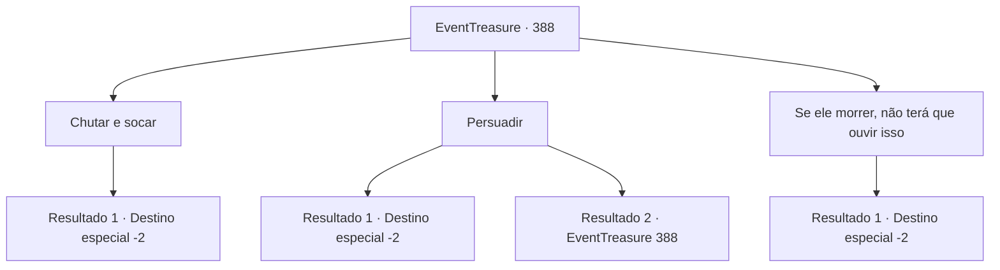

# Eventos de tesouro · 388

[Índice da tabela](index.md) · [Índice geral](../index.md)

ID: `pt:EventTreasure:388` · Fonte: `EventTreasure4` · Versão: 1.2.47.

Mapeamento estático dos arquivos; a disponibilidade e a execução dependem do estado da run.

## Texto do evento

*Sem texto no arquivo.*

## Dados de entrada

```json
{
  "id": 388,
  "grade": 1,
  "place": "",
  "required": ""
}
```

## Mapa das escolhas



## Escolhas e resultados

### Escolha 1

Chutar e socar

Requisitos e outros campos da escolha:

```json
{
  "required": ""
}
```

#### Resultado 1.1

Você deu uma boa surra no louco e o chutou para longe da cidade. Ele fugiu, choramingando que era um mouro. Você volta para o chefe e conta a ele sobre isso. 

 "Obrigado, pegue isso"

 Você pega o peixe dela. Então você se despede e deixa a aldeia.

Continuação registrada: [Destino especial `-2`](../destinos-especiais.md).

```json
{
  "required": "",
  "chance": "1",
  "nextEvent": -2,
  "type": 2,
  "reward": "5_618_9|3_125_1|0_3_-3"
}
```

### Escolha 2

Persuadir

Requisitos e outros campos da escolha:

```json
{
  "required": "5_624_0"
}
```

#### Resultado 2.1

Você sugere ao homem enlouquecido que ele vá para uma caverna onde as pessoas não possam vê-lo. Ele acena com a cabeça e concorda. 

 "Sim... Por que não pensei nisso antes? Heh... heh! Vou me esconder muito bem, seus bastardos, para que ninguém possa me encontrar!!!"

 Ele sai em busca de uma caverna. Você volta para o chefe da vila e informa a ela as notícias. Ela agradece a você e diz. 

 "Obrigada, você nem me ouviu, mas você deve ser especial, pegue isso"

 Você pega o peixe dela. Você se despede e deixa a vila.

Continuação registrada: [Destino especial `-2`](../destinos-especiais.md).

```json
{
  "required": "",
  "chance": "1|0_12_1",
  "nextEvent": -2,
  "type": 0,
  "reward": "5_618_9|3_125_1"
}
```

#### Resultado 2.2

Você está tentando convencer um homem louco de que ele está certo. Mas não importa o que você diga, ele não quer ouvir de jeito nenhum.

Continuação registrada: [Evento 388](0388.md) na mesma tabela.

```json
{
  "required": "",
  "chance": "16",
  "nextEvent": 388,
  "type": 1,
  "reward": "5_624_1"
}
```

### Escolha 3

Se ele morrer, não terá que ouvir isso

Requisitos e outros campos da escolha:

```json
{
  "required": "2_3_-14"
}
```

#### Resultado 3.1

Você pensa na maneira mais rápida de resolver o problema desse louco. Você silenciosamente pega uma pedra e bate com força em sua cabeça. Com um 'baque', seu corpo desaba. 

 "Ah... ah... você... o que está..."

 Assim, ele não sente mais nenhum olhar ou ansiedade. Você joga a pedra ensanguentada longe e deixa a cena.

Continuação registrada: [Destino especial `-2`](../destinos-especiais.md).

```json
{
  "required": "",
  "chance": "1",
  "nextEvent": -2,
  "type": 2,
  "reward": "5_618_9|0_3_-3"
}
```

## Referências que chegam a este evento

- [Evento 375 · escolha 1 · resultado 1](0375.md#escolha-1)
- [Evento 388 · escolha 2 · resultado 2](0388.md#escolha-2)
