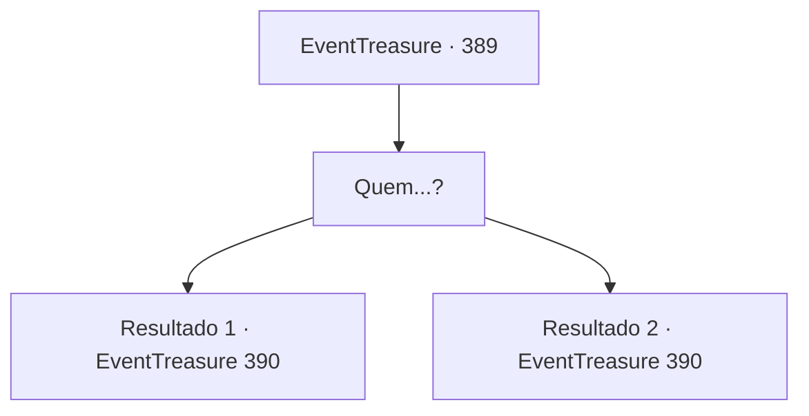

# Eventos de tesouro · 389

[Índice da tabela](index.md) · [Índice geral](../index.md)

ID: `pt:EventTreasure:389` · Fonte: `EventTreasure4` · Versão: 1.2.47.

Mapeamento estático dos arquivos; a disponibilidade e a execução dependem do estado da run.

## Texto do evento

Você é abordado por um homem que parece ser um soldado, vestido com um uniforme arrumado. 

 "É bom ver você. Da última vez, eu não tive tempo de me apresentar ou de agradecer. Eu te cumprimento formalmente. Eu sou 'Lierd'"

 Ele parece vagamente familiar.

## Dados de entrada

```json
{
  "id": 389,
  "grade": 1,
  "place": "",
  "required": "5_618_2"
}
```

## Mapa das escolhas



## Escolhas e resultados

### Escolha 1

Quem...?

Requisitos e outros campos da escolha:

```json
{
  "required": ""
}
```

#### Resultado 1.1

Após um momento de reflexão, você percebe que o viu na entrada de uma pequena vila de pescadores chamada Taran. Ele não parece nem um pouco desconfortável, nem cheira a sujeira. 

 "Felizmente você me reconhece. Graças a você, pude recuperar o juízo. Vim até você para retribuir"

 Ele pede um momento do seu tempo.

Continuação registrada: [Evento 390](0390.md) na mesma tabela.

```json
{
  "required": "",
  "chance": "1|0_7_1",
  "nextEvent": 390,
  "type": 0,
  "reward": ""
}
```

#### Resultado 1.2

Quando você não o reconhece, ele acena com a cabeça e diz. 

 "Hmm... Eu suponho que você poderia dizer isso. Eu vim te ajudar da última vez, e você salvou minha sanidade. Eu vim até você para retribuir isso"

 Ele pergunta se você tem um momento do seu tempo.

Continuação registrada: [Evento 390](0390.md) na mesma tabela.

```json
{
  "required": "",
  "chance": "1",
  "nextEvent": 390,
  "type": 1,
  "reward": ""
}
```

## Referências que chegam a este evento

Nenhum `nextEvent` positivo da mesma tabela aponta para este nó. Isso não prova que seja inacessível: sorteio e estado de história podem selecioná-lo.

