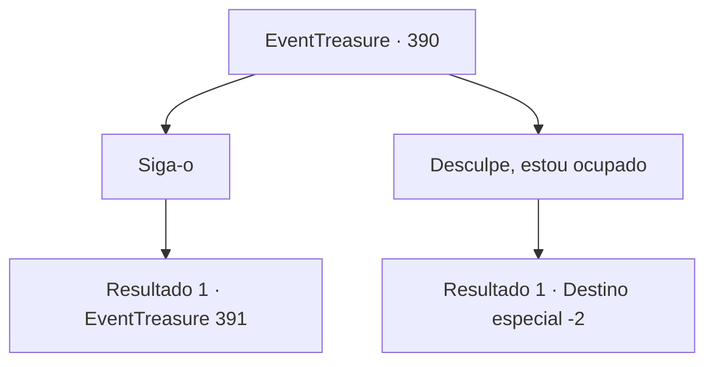

# Eventos de tesouro · 390

[Índice da tabela](index.md) · [Índice geral](../index.md)

ID: `pt:EventTreasure:390` · Fonte: `EventTreasure4` · Versão: 1.2.47.

Mapeamento estático dos arquivos; a disponibilidade e a execução dependem do estado da run.

## Texto do evento

*Sem texto no arquivo.*

## Dados de entrada

```json
{
  "id": 390,
  "grade": 1,
  "place": "",
  "required": ""
}
```

## Mapa das escolhas



## Escolhas e resultados

### Escolha 1

Siga-o

Requisitos e outros campos da escolha:

```json
{
  "required": ""
}
```

#### Resultado 1.1

Você o seguiu até uma cidade próxima. Ela é chamada de 'Nine Tails' porque nove rios a atravessam. A cidade é pontilhada de vias navegáveis, com pequenos barcos viajando entre elas. Lierd te leva a uma taverna à beira-mar. 

 "Este é um lugar que costumava frequentar. Embora o nome tenha mudado..."

 Ele se senta na varanda com vista para o mar, observando o pôr do sol. Enquanto você se senta, um garçom se aproxima e diz. 

 "Posso ajudar com o seu pedido?"

 Lierd responde. 

 "Vou querer o que você tem mais confiança e duas cervejas escuras."

 O garçom balança a cabeça e vai para a cozinha. Lierd olha para o oceano sem dizer uma palavra.

Continuação registrada: [Evento 391](0391.md) na mesma tabela.

```json
{
  "required": "",
  "chance": "1",
  "nextEvent": 391,
  "type": 2,
  "reward": ""
}
```

### Escolha 2

Desculpe, estou ocupado

Requisitos e outros campos da escolha:

```json
{
  "required": ""
}
```

#### Resultado 2.1

Você recusa a oferta dele. Ele diz com uma expressão triste. 

 "Entendo... Sinto muito, mas por favor aceite isso"

 Lierd diz que ganhou lutando contra as sereias, e te entrega uma besta feita de coral. 

 "Muito obrigado, não esquecerei da sua gentileza, fique seguro"

 Ele se despede educadamente e parte.

Continuação registrada: [Destino especial `-2`](../destinos-especiais.md).

```json
{
  "required": "",
  "chance": "1",
  "nextEvent": -2,
  "type": 2,
  "reward": "5_618_9|3_215_1"
}
```

## Referências que chegam a este evento

- [Evento 389 · escolha 1 · resultado 1](0389.md#escolha-1)
- [Evento 389 · escolha 1 · resultado 2](0389.md#escolha-1)
