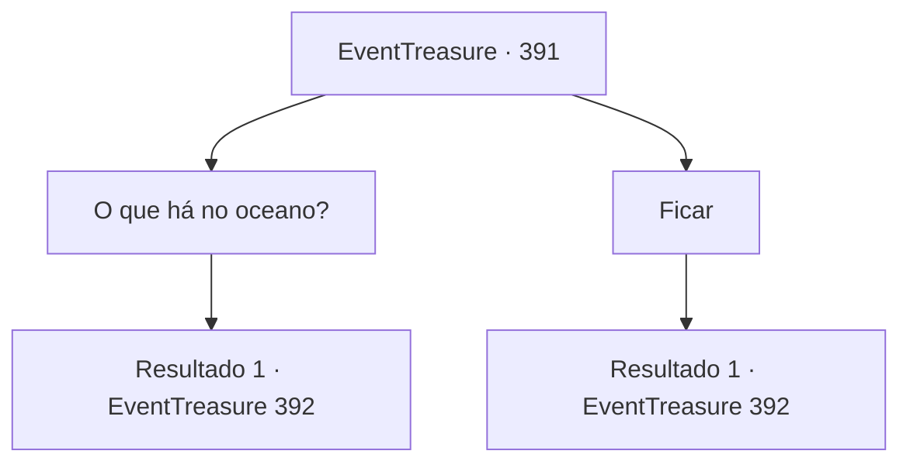

# Eventos de tesouro · 391

[Índice da tabela](index.md) · [Índice geral](../index.md)

ID: `pt:EventTreasure:391` · Fonte: `EventTreasure4` · Versão: 1.2.47.

Mapeamento estático dos arquivos; a disponibilidade e a execução dependem do estado da run.

## Texto do evento

*Sem texto no arquivo.*

## Dados de entrada

```json
{
  "id": 391,
  "grade": 1,
  "place": "",
  "required": ""
}
```

## Mapa das escolhas



## Escolhas e resultados

### Escolha 1

O que há no oceano?

Requisitos e outros campos da escolha:

```json
{
  "required": ""
}
```

#### Resultado 1.1

Em resposta à sua pergunta, ele sorri e diz. 

 "Bem... eu suponho que eu seja um pouco tolo. Já que você quer voltar ao mar depois do que aconteceu com você"

 Ele olha para você com um sorriso irônico. 

 "Desculpe, eu estava olhando para o oceano quando te chamei"

 Nesse momento, o garçom retorna e coloca sua lagosta e cerveja preta na mesa. Ele sai dizendo, 'Aproveite sua refeição'. 

 "Aqui está. Aproveite."


Continuação registrada: [Evento 392](0392.md) na mesma tabela.

```json
{
  "required": "",
  "chance": "1",
  "nextEvent": 392,
  "type": 2,
  "reward": ""
}
```

### Escolha 2

Ficar

Requisitos e outros campos da escolha:

```json
{
  "required": ""
}
```

#### Resultado 2.1

Ele ficou olhando para o mar por um tempo e de repente percebeu sua presença. Ele olha para você com um sorriso irônico. 

 "Desculpe, eu estava olhando para o oceano quando te chamei"

 Nesse momento, o garçom retorna e coloca sua lagosta e cerveja preta na mesa. Ele sai dizendo, 'Aproveite sua refeição'. 

 "Aqui está. Aproveite."


Continuação registrada: [Evento 392](0392.md) na mesma tabela.

```json
{
  "required": "",
  "chance": "1",
  "nextEvent": 392,
  "type": 2,
  "reward": ""
}
```

## Referências que chegam a este evento

- [Evento 390 · escolha 1 · resultado 1](0390.md#escolha-1)
