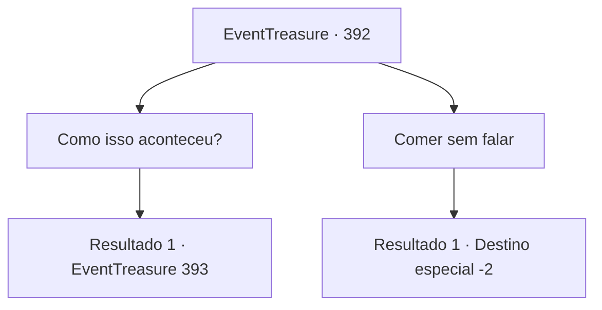

# Eventos de tesouro · 392

[Índice da tabela](index.md) · [Índice geral](../index.md)

ID: `pt:EventTreasure:392` · Fonte: `EventTreasure4` · Versão: 1.2.47.

Mapeamento estático dos arquivos; a disponibilidade e a execução dependem do estado da run.

## Texto do evento

*Sem texto no arquivo.*

## Dados de entrada

```json
{
  "id": 392,
  "grade": 1,
  "place": "",
  "required": ""
}
```

## Mapa das escolhas



## Escolhas e resultados

### Escolha 1

Como isso aconteceu?

Requisitos e outros campos da escolha:

```json
{
  "required": ""
}
```

#### Resultado 1.1

Em resposta à sua pergunta, Lierd dá um gole em sua cerveja escura e responde. 

 "Não tenho certeza. Talvez eu tenha sido amaldiçoado enquanto matava monstros marinhos, lutando contra sereias, ou se os espíritos dos piratas que perderam suas vidas pelas minhas mãos me enlouqueceram..."

 Enquanto você o ouve, coloca a lagosta na boca e geme. Ele mexe a carne da lagosta com o garfo e continua. 

 "Eu... Eu era um capitão da marinha do reino de Axenbruck, localizado na parte norte do continente. Por mandato real, eu lidava com ameaças do mar. Mas em algum momento, a ansiedade e a dúvida me corroeram, e eu me perdi, e acabei perdendo minha frota e meus homens..."


Continuação registrada: [Evento 393](0393.md) na mesma tabela.

```json
{
  "required": "",
  "chance": "1",
  "nextEvent": 393,
  "type": 2,
  "reward": ""
}
```

### Escolha 2

Comer sem falar

Requisitos e outros campos da escolha:

```json
{
  "required": ""
}
```

#### Resultado 2.1

Você come sua refeição sem dizer uma palavra. Entre você e Lierd, há apenas o tilintar dos talheres, e o barulho da carne de lagosta. Quando Lierd termina, ele olha para você por um momento, então fala. 

 "Você é reticente. Há um ditado. Eloquência é prata, silêncio é ouro... Foi um prazer conhecê-lo. Aqui está minha recompensa por salvar sua vida. Por favor, pegue"

 Lierd diz que ganhou isso lutando contra sereias, e te entrega uma besta feita de coral. 

 "Estou verdadeiramente grato. Não esquecerei esse favor. Fique seguro."

 Ele se despede educadamente e parte.

Continuação registrada: [Destino especial `-2`](../destinos-especiais.md).

```json
{
  "required": "",
  "chance": "1",
  "nextEvent": -2,
  "type": 2,
  "reward": "5_618_9|3_215_1|0_0_1|0_2_1"
}
```

## Referências que chegam a este evento

- [Evento 391 · escolha 1 · resultado 1](0391.md#escolha-1)
- [Evento 391 · escolha 2 · resultado 1](0391.md#escolha-2)
