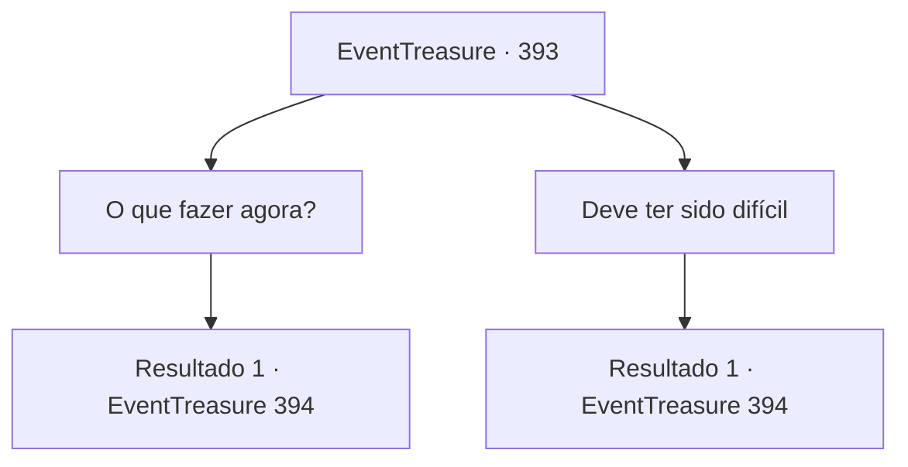

# Eventos de tesouro · 393

[Índice da tabela](index.md) · [Índice geral](../index.md)

ID: `pt:EventTreasure:393` · Fonte: `EventTreasure4` · Versão: 1.2.47.

Mapeamento estático dos arquivos; a disponibilidade e a execução dependem do estado da run.

## Texto do evento

*Sem texto no arquivo.*

## Dados de entrada

```json
{
  "id": 393,
  "grade": 1,
  "place": "",
  "required": ""
}
```

## Mapa das escolhas



## Escolhas e resultados

### Escolha 1

O que fazer agora?

Requisitos e outros campos da escolha:

```json
{
  "required": ""
}
```

#### Resultado 1.1

Ele franze a testa ao ouvir sua pergunta e diz. 

 "É... Eu não sei. Eu adoraria voltar para a marinha, mas... Tenho tanto medo de ser amaldiçoado novamente e perder meus homens e a mim mesmo. O que você acha que faria se estivesse no meu lugar?"


Continuação registrada: [Evento 394](0394.md) na mesma tabela.

```json
{
  "required": "",
  "chance": "1",
  "nextEvent": 394,
  "type": 2,
  "reward": ""
}
```

### Escolha 2

Deve ter sido difícil

Requisitos e outros campos da escolha:

```json
{
  "required": ""
}
```

#### Resultado 2.1

Você simpatiza com a dor dele e oferece a ele algum consolo morno. Ele solta um longo suspiro e diz. 

 "Eu agradeço. Mas mais do que isso, eu estava esperando que você pudesse me aconselhar sobre o que fazer a seguir. Eu gostaria de voltar para a marinha, mas tenho medo... Tenho medo de ser amaldiçoado novamente e perder meus homens e a mim mesmo. O que você acha que faria se estivesse no meu lugar?"


Continuação registrada: [Evento 394](0394.md) na mesma tabela.

```json
{
  "required": "",
  "chance": "1",
  "nextEvent": 394,
  "type": 2,
  "reward": ""
}
```

## Referências que chegam a este evento

- [Evento 392 · escolha 1 · resultado 1](0392.md#escolha-1)
