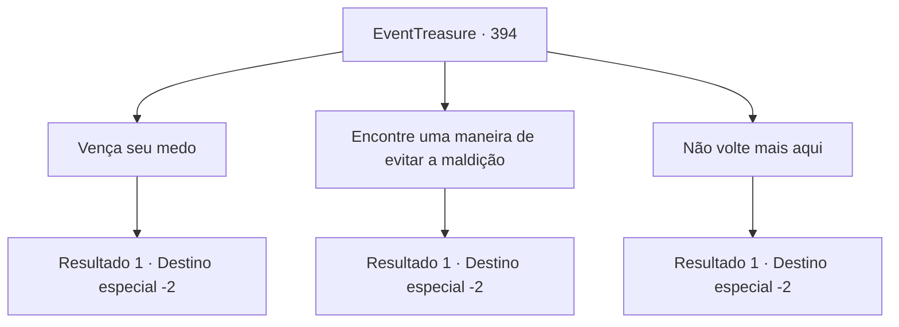

# Eventos de tesouro · 394

[Índice da tabela](index.md) · [Índice geral](../index.md)

ID: `pt:EventTreasure:394` · Fonte: `EventTreasure4` · Versão: 1.2.47.

Mapeamento estático dos arquivos; a disponibilidade e a execução dependem do estado da run.

## Texto do evento

*Sem texto no arquivo.*

## Dados de entrada

```json
{
  "id": 394,
  "grade": 1,
  "place": "",
  "required": ""
}
```

## Mapa das escolhas



## Escolhas e resultados

### Escolha 1

Vença seu medo

Requisitos e outros campos da escolha:

```json
{
  "required": ""
}
```

#### Resultado 1.1

Você o aconselha a conquistar seus medos. Ele dá um longo gole em sua cerveja e coloca o copo na mesa. 

 "Sim. Provavelmente está certo. Obrigado. Foi um prazer conhecê-lo. Aqui, por salvar minha vida, por favor aceite."

 Lierd diz que ganhou isso lutando contra sereias, e lhe entrega uma besta feita de coral. 

 "Estou verdadeiramente grato. Não esquecerei esse favor. Fique seguro"

 Ele se despede educadamente e parte.

Continuação registrada: [Destino especial `-2`](../destinos-especiais.md).

```json
{
  "required": "",
  "chance": "1",
  "nextEvent": -2,
  "type": 2,
  "reward": "5_618_9|3_215_1|0_0_1|0_2_1"
}
```

### Escolha 2

Encontre uma maneira de evitar a maldição

Requisitos e outros campos da escolha:

```json
{
  "required": ""
}
```

#### Resultado 2.1

Você o aconselha a encontrar uma maneira de evitar ser amaldiçoado. Ele bebe a cerveja de uma só vez e coloca o copo na mesa. 

 "Obrigado. Como está... Não há garantia de que não acontecerá novamente. Foi um prazer conhecê-lo. Aqui, por salvar minha vida, por favor aceite."

 Lierd diz que ele ganhou isso lutando contra sereias, e lhe entrega uma besta feita de coral. 

 "Estou realmente grato. Não vou esquecer esse favor. Fique seguro"

 Ele se despede educadamente e parte.

Continuação registrada: [Destino especial `-2`](../destinos-especiais.md).

```json
{
  "required": "",
  "chance": "1",
  "nextEvent": -2,
  "type": 2,
  "reward": "5_618_9|3_215_1|0_0_1|0_2_1"
}
```

### Escolha 3

Não volte mais aqui

Requisitos e outros campos da escolha:

```json
{
  "required": ""
}
```

#### Resultado 3.1

Você o aconselha a não voltar. Ele bate os dedos na mesa. 

 "Sim... obrigado, foi bom te conhecer. Aqui, isso é para me salvar, por favor, pegue."

 Lierd diz que ganhou isso lutando contra sereias, e te entrega uma besta feita de coral. 

 "Estou realmente grato. Não esquecerei esse favor. Fique seguro"

 Ele se despede educadamente e parte.

Continuação registrada: [Destino especial `-2`](../destinos-especiais.md).

```json
{
  "required": "",
  "chance": "1",
  "nextEvent": -2,
  "type": 2,
  "reward": "5_618_9|3_215_1|0_0_1|0_2_1"
}
```

## Referências que chegam a este evento

- [Evento 393 · escolha 1 · resultado 1](0393.md#escolha-1)
- [Evento 393 · escolha 2 · resultado 1](0393.md#escolha-2)
