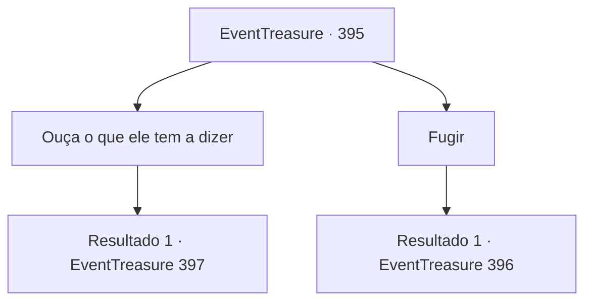

# Eventos de tesouro · 395

[Índice da tabela](index.md) · [Índice geral](../index.md)

ID: `pt:EventTreasure:395` · Fonte: `EventTreasure4` · Versão: 1.2.47.

Mapeamento estático dos arquivos; a disponibilidade e a execução dependem do estado da run.

## Texto do evento

Em uma noite escura sem lua à vista, você caminha pelo caminho e encontra um homem de meia-idade vestido com roupas esfarrapadas. Um martelo de ferreiro pende em sua cintura, e seu rosto e roupas estão manchados de fuligem. No breve momento em que você o observa, ele de repente dá um passo à frente e agarra sua mão. 

 "Eu esperei por alguém por alguem por você por décadas, você pode me emprestar sua ajuda?."


## Dados de entrada

```json
{
  "id": 395,
  "grade": 2,
  "place": "",
  "required": "8_336_1|5_768_0|20_46_2|10_337_1"
}
```

## Mapa das escolhas



## Escolhas e resultados

### Escolha 1

Ouça o que ele tem a dizer

Requisitos e outros campos da escolha:

```json
{
  "required": ""
}
```

#### Resultado 1.1

Ele começa a contar sua história com uma voz sincera. 

 "Meu próprio nome é 'Ganjang.' Eu era um ferreiro em uma terra distante do leste, renomado em todos os reinos por meu ofício. Um dia, o rei ordenou que eu forjasse a maior espada que o mundo já viu."

 Ele disse que foi compelido a obedecer à ordem real, como se estivesse possuído. 

 "Eu derramei todo o meu ser na forja de um par de lâminas. Uma eu nomeei em minha homenagem, 'Ganjang', e a outra em homenagem à minha esposa, 'Makya.'"

 Ele explicou que havia infundido Makya com o cabelo e o sangue de sua esposa, e Ganjang com seu próprio cabelo e sangue. 

 "As lâminas eram realmente impecáveis—obras-primas em todos os aspectos. No entanto, ao concluí-las, uma estranha inquietação tomou conta do meu coração. Pensei que o rei me mataria assim que eu apresentasse essas espadas a ele."

 Ele disse que não podia confiar no rei. Então, pediu à sua esposa que escondesse Makya enquanto ele levava Ganjang ao rei. E sua premonição estava correta. O rei executou o ferreiro após receber Ganjang.

Continuação registrada: [Evento 397](0397.md) na mesma tabela.

```json
{
  "required": "",
  "chance": "1",
  "nextEvent": 397,
  "type": 2,
  "reward": "5_768_1"
}
```

### Escolha 2

Fugir

Requisitos e outros campos da escolha:

```json
{
  "required": ""
}
```

#### Resultado 2.1

Você tenta fugir, mas seu corpo se debate como se estivesse se afogando. O ferreiro agarra seu braço e diz: 

 "Contemple isto! Eu te suplico, ajude-me a encontrar minha esposa. Se recusares, posso muito bem ser levado a chorar."

 Ele te avisa que, se chorar, algo muito desagradável acontecerá.

Continuação registrada: [Evento 396](0396.md) na mesma tabela.

```json
{
  "required": "",
  "chance": "1",
  "nextEvent": 396,
  "type": 2,
  "reward": "5_768_2"
}
```

## Referências que chegam a este evento

Nenhum `nextEvent` positivo da mesma tabela aponta para este nó. Isso não prova que seja inacessível: sorteio e estado de história podem selecioná-lo.

