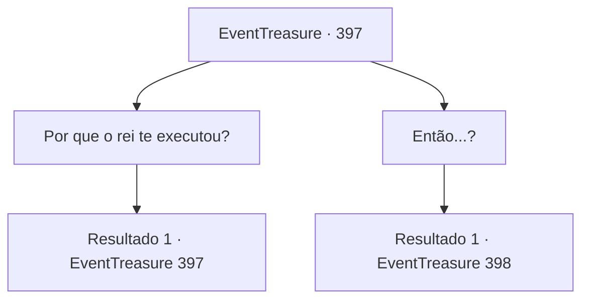

# Eventos de tesouro · 397

[Índice da tabela](index.md) · [Índice geral](../index.md)

ID: `pt:EventTreasure:397` · Fonte: `EventTreasure4` · Versão: 1.2.47.

Mapeamento estático dos arquivos; a disponibilidade e a execução dependem do estado da run.

## Texto do evento

*Sem texto no arquivo.*

## Dados de entrada

```json
{
  "id": 397,
  "grade": 1,
  "place": "",
  "required": ""
}
```

## Mapa das escolhas



## Escolhas e resultados

### Escolha 1

Por que o rei te executou?

Requisitos e outros campos da escolha:

```json
{
  "required": "5_769_0"
}
```

#### Resultado 1.1

Em resposta à sua pergunta, Ganjang diz que não sabe ao certo. 

 "Para ser honesto, não tenho certeza absoluta. Talvez o rei estivesse preocupado que eu pudesse levar minhas habilidades para outro país. Se uma obra-prima como essa acabasse nas mãos do inimigo, poderia se tornar uma ameaça para ele."


Continuação registrada: [Evento 397](0397.md) na mesma tabela.

```json
{
  "required": "",
  "chance": "1",
  "nextEvent": 397,
  "type": 2,
  "reward": "5_769_1"
}
```

### Escolha 2

Então...?

Requisitos e outros campos da escolha:

```json
{
  "required": ""
}
```

#### Resultado 2.1

O ferreiro olha para a distância com uma expressão nostálgica e diz: 

 "No final, minha alma se tornou ligada a esta espada. O rei, cheio de confiança, levou Ganjang para a batalha, mas encontrou uma morte rápida e inútil. Não importa quão extraordinária uma lâmina possa ser, seu verdadeiro valor depende da habilidade de quem a maneja..."

 Ele abaixa a cabeça por um momento, depois a levanta novamente com um suspiro profundo e continua: 

 "Depois disso, fui passado de uma mão para outra. Incontáveis guerreiros e soldados me procuraram—como poderiam não fazê-lo? Mas isso nunca foi o que eu desejei... Tudo o que eu sempre quis foi voltar para minha esposa."

 Sua voz se torna mais suave, e o silêncio cai entre vocês. 

 "Mas tudo deu errado. Não sei como aconteceu, mas de alguma forma, a alma da minha esposa acabou ligada a Makya. Como eu, ela também se tornou uma errante, incapaz de encontrar descanso."

 Ganjang explica que já faz um tempo inimaginável e, com uma voz carregada de emoção, ele implora a você. 

 "Eu desejo ver minha esposa novamente. Você é um aventureiro habilidoso, não é? Por favor, conceda-me este único pedido. Ajude-me nesta jornada para encontrá-la. Estou implorando a você."


Continuação registrada: [Evento 398](0398.md) na mesma tabela.

```json
{
  "required": "",
  "chance": "1",
  "nextEvent": 398,
  "type": 2,
  "reward": ""
}
```

## Referências que chegam a este evento

- [Evento 395 · escolha 1 · resultado 1](0395.md#escolha-1)
- [Evento 396 · escolha 1 · resultado 1](0396.md#escolha-1)
- [Evento 397 · escolha 1 · resultado 1](0397.md#escolha-1)
