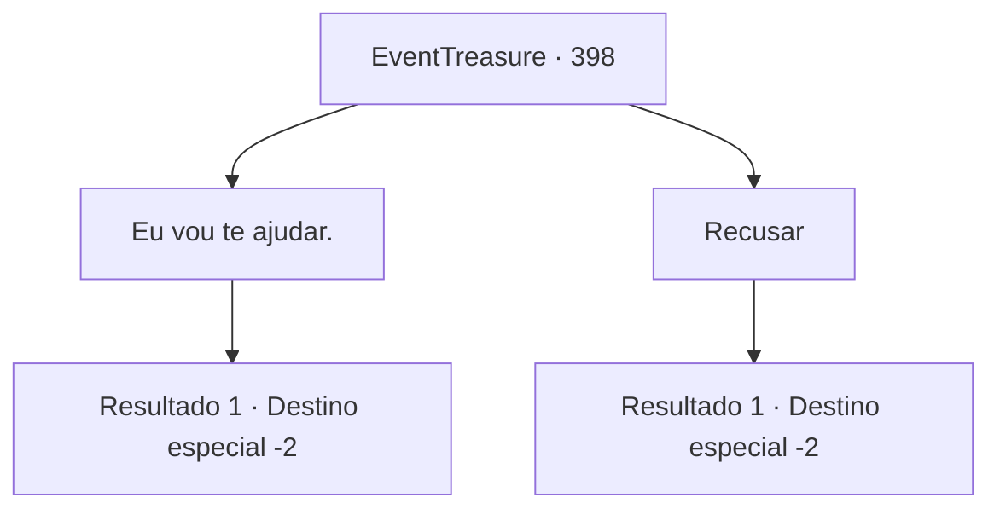

# Eventos de tesouro · 398

[Índice da tabela](index.md) · [Índice geral](../index.md)

ID: `pt:EventTreasure:398` · Fonte: `EventTreasure4` · Versão: 1.2.47.

Mapeamento estático dos arquivos; a disponibilidade e a execução dependem do estado da run.

## Texto do evento

*Sem texto no arquivo.*

## Dados de entrada

```json
{
  "id": 398,
  "grade": 1,
  "place": "",
  "required": ""
}
```

## Mapa das escolhas



## Escolhas e resultados

### Escolha 1

Eu vou te ajudar.

Requisitos e outros campos da escolha:

```json
{
  "required": ""
}
```

#### Resultado 1.1

Quando você concorda com o pedido dele, ele agarra suas mãos e as sacode vigorosamente. 

 "Muito obrigado. Primeiro, vamos para o norte. Minha esposa deve estar naquela direção. Eu te aviso quando estivermos mais perto."

 Com essas palavras, o ferreiro se dissolve em fumaça, e você abre os olhos. Despertando do sonho, você sai da sua tenda e parte para sua aventura.

Continuação registrada: [Destino especial `-2`](../destinos-especiais.md).

```json
{
  "required": "",
  "chance": "1",
  "nextEvent": -2,
  "type": 2,
  "reward": "5_770_1"
}
```

### Escolha 2

Recusar

Requisitos e outros campos da escolha:

```json
{
  "required": ""
}
```

#### Resultado 2.1

Quando você recusa, o ferreiro desaparece com uma expressão de desagrado. Você então abre os olhos. Despertando do sonho, você sai da sua tenda e parte para a sua aventura.

Continuação registrada: [Destino especial `-2`](../destinos-especiais.md).

```json
{
  "required": "",
  "chance": "1",
  "nextEvent": -2,
  "type": 2,
  "reward": "5_771_1"
}
```

## Referências que chegam a este evento

- [Evento 397 · escolha 2 · resultado 1](0397.md#escolha-2)
