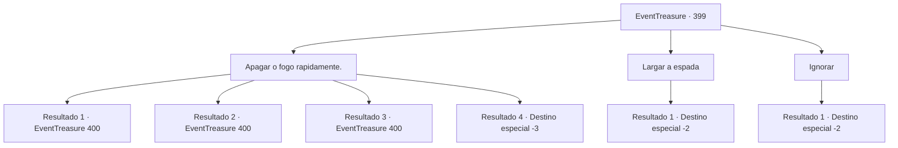

# Eventos de tesouro · 399

[Índice da tabela](index.md) · [Índice geral](../index.md)

ID: `pt:EventTreasure:399` · Fonte: `EventTreasure4` · Versão: 1.2.47.

Mapeamento estático dos arquivos; a disponibilidade e a execução dependem do estado da run.

## Texto do evento

De repente, você sente uma sensação de tremor. Começa pela espada que você está segurando—'Ganjang.' 

 "Ah... Ah... Makya! Como eu anseio por te ver!"

 Uma voz familiar ecoa em sua mente—os gritos tristes do ferreiro que você encontrou em seu sonho. O tremor, como uma vibração de soluço da espada, fica cada vez mais forte, até que, de repente, chamas irrompem, avançando em sua direção como se fossem te consumir.

## Dados de entrada

```json
{
  "id": 399,
  "grade": 1,
  "place": "",
  "required": "5_771_1|8_336_1|10_337_1"
}
```

## Mapa das escolhas



## Escolhas e resultados

### Escolha 1

Apagar o fogo rapidamente.

Requisitos e outros campos da escolha:

```json
{
  "required": ""
}
```

#### Resultado 1.1

Você respira um ar gelado para extinguir as chamas. No entanto, Ganjang não desistiu de encontrar sua esposa. 

 "Makya... Por favor, encontre Makya..."


Continuação registrada: [Evento 400](0400.md) na mesma tabela.

```json
{
  "required": "20_12_1",
  "chance": "1",
  "nextEvent": 400,
  "type": 2,
  "reward": ""
}
```

#### Resultado 1.2

Você respira um ar gelado para extinguir as chamas. No entanto, Ganjang não desistiu de encontrar sua esposa. 

 "Makya... Por favor, encontre Makya..."


Continuação registrada: [Evento 400](0400.md) na mesma tabela.

```json
{
  "required": "21_12_1",
  "chance": "1|0_6_1",
  "nextEvent": 400,
  "type": 0,
  "reward": ""
}
```

#### Resultado 1.3

Você tenta apressadamente extinguir as chamas que se espalharam pelo seu corpo. No entanto, o fogo não se apaga facilmente, e você se vê contorcendo-se no chão em agonia devido à dor lancinante. Mesmo assim, Ganjang ainda parece insatisfeito. 

 "Makya... Por favor, encontre Makya..."


Continuação registrada: [Evento 400](0400.md) na mesma tabela.

```json
{
  "required": "21_12_1|1_0_2",
  "chance": "16",
  "nextEvent": 400,
  "type": 1,
  "reward": "0_0_-1"
}
```

#### Resultado 1.4

Você apressadamente tenta extinguir as chamas que se agarram ao seu corpo. No entanto, o fogo não se apaga rapidamente e transforma todo o seu corpo em um monte de carvão.

Continuação registrada: [Destino especial `-3`](../destinos-especiais.md).

```json
{
  "required": "21_12_1|2_0_2",
  "chance": "16",
  "nextEvent": -3,
  "type": 1,
  "reward": "0_0_-1"
}
```

### Escolha 2

Largar a espada

Requisitos e outros campos da escolha:

```json
{
  "required": ""
}
```

#### Resultado 2.1

Você joga a espada em chamas para longe. Em seguida, você imediatamente foge.

Continuação registrada: [Destino especial `-2`](../destinos-especiais.md).

```json
{
  "required": "",
  "chance": "1",
  "nextEvent": -2,
  "type": 2,
  "reward": "4_336_1|5_771_9"
}
```

### Escolha 3

Ignorar

Requisitos e outros campos da escolha:

```json
{
  "required": "20_13_3"
}
```

#### Resultado 3.1

Como chamas desse nível não representam problema para você, você decide simplesmente ignorá-las. No entanto, Ganjang não desistiu de encontrar sua esposa. 

 "Makya... Por favor, encontre Makya..."

 Você deliberadamente ignora seus sussurros e coloca a espada de volta na sua mochila.

Continuação registrada: [Destino especial `-2`](../destinos-especiais.md).

```json
{
  "required": "",
  "chance": "1",
  "nextEvent": -2,
  "type": 2,
  "reward": ""
}
```

## Referências que chegam a este evento

Nenhum `nextEvent` positivo da mesma tabela aponta para este nó. Isso não prova que seja inacessível: sorteio e estado de história podem selecioná-lo.

