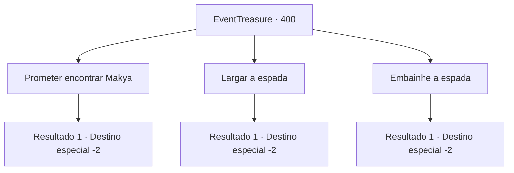

# Eventos de tesouro · 400

[Índice da tabela](index.md) · [Índice geral](../index.md)

ID: `pt:EventTreasure:400` · Fonte: `EventTreasure4` · Versão: 1.2.47.

Mapeamento estático dos arquivos; a disponibilidade e a execução dependem do estado da run.

## Texto do evento

*Sem texto no arquivo.*

## Dados de entrada

```json
{
  "id": 400,
  "grade": 1,
  "place": "",
  "required": ""
}
```

## Mapa das escolhas



## Escolhas e resultados

### Escolha 1

Prometer encontrar Makya

Requisitos e outros campos da escolha:

```json
{
  "required": ""
}
```

#### Resultado 1.1

Você promete encontrar Makya. Com isso, o tremor da espada diminui, e as chamas se apagam. Você embainha a espada e começa sua jornada para encontrar Makya.

Continuação registrada: [Destino especial `-2`](../destinos-especiais.md).

```json
{
  "required": "",
  "chance": "1",
  "nextEvent": -2,
  "type": 2,
  "reward": "5_770_1|5_771_2"
}
```

### Escolha 2

Largar a espada

Requisitos e outros campos da escolha:

```json
{
  "required": ""
}
```

#### Resultado 2.1

Você joga a espada em chamas para longe. Em seguida, você imediatamente foge.

Continuação registrada: [Destino especial `-2`](../destinos-especiais.md).

```json
{
  "required": "",
  "chance": "1",
  "nextEvent": -2,
  "type": 2,
  "reward": "4_336_1|5_771_9"
}
```

### Escolha 3

Embainhe a espada

Requisitos e outros campos da escolha:

```json
{
  "required": ""
}
```

#### Resultado 3.1

Você deliberadamente ignora seus sussurros e coloca a espada de volta na sua mochila.

Continuação registrada: [Destino especial `-2`](../destinos-especiais.md).

```json
{
  "required": "",
  "chance": "1",
  "nextEvent": -2,
  "type": 2,
  "reward": ""
}
```

## Referências que chegam a este evento

- [Evento 399 · escolha 1 · resultado 1](0399.md#escolha-1)
- [Evento 399 · escolha 1 · resultado 2](0399.md#escolha-1)
- [Evento 399 · escolha 1 · resultado 3](0399.md#escolha-1)
