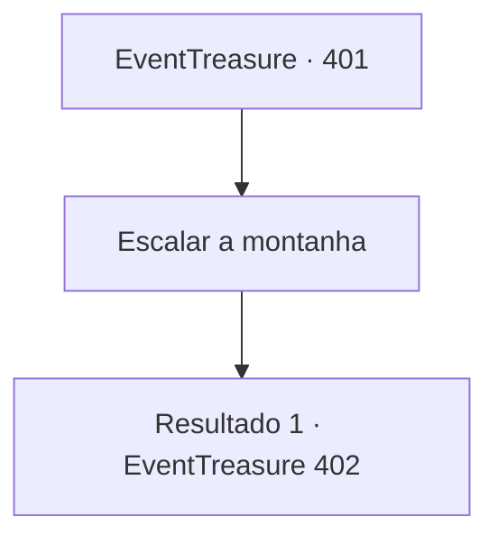

# Eventos de tesouro · 401

[Índice da tabela](index.md) · [Índice geral](../index.md)

ID: `pt:EventTreasure:401` · Fonte: `EventTreasure4` · Versão: 1.2.47.

Mapeamento estático dos arquivos; a disponibilidade e a execução dependem do estado da run.

## Texto do evento

A montanha coberta de neve se ergue majestosamente diante de você. É um dos muitos picos da cordilheira Ratnagar. Embora não seja o mais alto, é infame por seu terreno traiçoeiro. De repente, um tremor percorre você. Ele se origina da espada que você carrega—'Ganjang.' 

 "Além... bem além... Minha própria esposa me chama daquele lugar..."

 Uma voz familiar ecoa em sua mente. É a voz do ferreiro, Ganjang, que você conheceu em seu sonho.

## Dados de entrada

```json
{
  "id": 401,
  "grade": 1,
  "place": "",
  "required": "5_770_1|8_336_1|10_337_1"
}
```

## Mapa das escolhas



## Escolhas e resultados

### Escolha 1

Escalar a montanha

Requisitos e outros campos da escolha:

```json
{
  "required": ""
}
```

#### Resultado 1.1

A cada passo que você dá em direção ao cume, o vento, cheio de neve e gelo, uiva ferozmente ao seu redor. No entanto, o calor emanado da espada o protege da nevasca que sopra em sua direção. 

 Cerca de metade do caminho até a montanha, você se depara com um lobo do inverno faminto. Ele rosna baixo e fixa seu olhar penetrante em você.

Continuação registrada: [Evento 402](0402.md) na mesma tabela.

```json
{
  "required": "",
  "chance": "1",
  "nextEvent": 402,
  "type": 2,
  "reward": ""
}
```

## Referências que chegam a este evento

Nenhum `nextEvent` positivo da mesma tabela aponta para este nó. Isso não prova que seja inacessível: sorteio e estado de história podem selecioná-lo.

