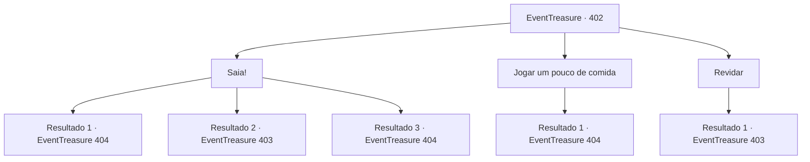

# Eventos de tesouro · 402

[Índice da tabela](index.md) · [Índice geral](../index.md)

ID: `pt:EventTreasure:402` · Fonte: `EventTreasure4` · Versão: 1.2.47.

Mapeamento estático dos arquivos; a disponibilidade e a execução dependem do estado da run.

## Texto do evento

*Sem texto no arquivo.*

## Dados de entrada

```json
{
  "id": 402,
  "grade": 1,
  "place": "",
  "required": ""
}
```

## Mapa das escolhas



## Escolhas e resultados

### Escolha 1

Saia!

Requisitos e outros campos da escolha:

```json
{
  "required": ""
}
```

#### Resultado 1.1

Ao seu grito feroz, o lobo do inverno se encolhe de medo, enfia o rabo entre as pernas e foge. Com o obstáculo removido, você continua subindo a montanha sem pausa. Eventualmente, você chega à entrada de uma caverna, onde o tremor da espada em sua mão se intensifica. A caverna não parece ter se formado naturalmente; parece que algum ser colossal a esculpiu deliberadamente. Ao entrar na caverna, você vê suas paredes revestidas de gelo com um leve tom azul. O gelo brilha intensamente, refletindo a luz que entra pelo teto desmoronado acima. Você caminha mais para dentro da caverna. Logo, você se depara com o mestre deste covil: um Dragão Branco, conhecido como o Rei das Montanhas Nevadas. Seus olhos amarelos penetrantes brilham enquanto ele o observa atentamente.

Continuação registrada: [Evento 404](0404.md) na mesma tabela.

```json
{
  "required": "21_1_4",
  "chance": "1|0_12_1",
  "nextEvent": 404,
  "type": 0,
  "reward": ""
}
```

#### Resultado 1.2

Você tenta intimidar o lobo do inverno. No entanto, isso sai pela culatra. O lobo, agora enfurecido, avança ferozmente em sua direção.

Continuação registrada: [Evento 403](0403.md) na mesma tabela.

```json
{
  "required": "21_1_4",
  "chance": "16",
  "nextEvent": 403,
  "type": 1,
  "reward": "6_3_88",
  "place": 9
}
```

#### Resultado 1.3

Ao seu grito feroz, o lobo do inverno se encolhe de medo, enfia o rabo entre as pernas e foge. Com o obstáculo removido, você continua subindo a montanha sem pausa. Eventualmente, você chega à entrada de uma caverna, onde o tremor da espada em sua mão se intensifica. A caverna não parece ter se formado naturalmente; parece que algum ser colossal a esculpiu deliberadamente. Ao entrar na caverna, você vê suas paredes revestidas de gelo com um leve tom azul. O gelo brilha intensamente, refletindo a luz que entra pelo teto desmoronado acima. Você caminha mais para dentro da caverna. Logo, você se depara com o mestre deste covil: um Dragão Branco, conhecido como o Rei das Montanhas Nevadas. Seus olhos amarelos penetrantes brilham enquanto ele o observa atentamente.

Continuação registrada: [Evento 404](0404.md) na mesma tabela.

```json
{
  "required": "20_1_4",
  "chance": "1",
  "nextEvent": 404,
  "type": 2,
  "reward": ""
}
```

### Escolha 2

Jogar um pouco de comida

Requisitos e outros campos da escolha:

```json
{
  "required": "23_0_1"
}
```

#### Resultado 2.1

Você tira um pouco de comida, agita na frente do lobo e depois a joga longe. O lobo do inverno, babando de fome, corre atrás dela sem hesitação. Com o obstáculo removido, você continua subindo a montanha sem parar. Eventualmente, você chega à entrada de uma caverna, onde a tremedeira da espada em sua mão fica mais forte. A caverna não parece ter se formado naturalmente; parece que algum ser colossal a esculpiu deliberadamente. Ao entrar na caverna, você vê suas paredes revestidas de gelo com um leve tom azul. O gelo brilha intensamente, refletindo a luz que entra pelo teto desmoronado acima. Você caminha mais para dentro da caverna. Logo, você se depara com o mestre deste covil: um Dragão Branco, conhecido como o Rei das Montanhas Nevadas. Seus olhos amarelos penetrantes brilham enquanto ele te observa atentamente.

Continuação registrada: [Evento 404](0404.md) na mesma tabela.

```json
{
  "required": "",
  "chance": "1",
  "nextEvent": 404,
  "type": 2,
  "reward": "25_0_1"
}
```

### Escolha 3

Revidar

Requisitos e outros campos da escolha:

```json
{
  "required": ""
}
```

#### Resultado 3.1

Sem hesitação, você avança diretamente contra o lobo do inverno.

Continuação registrada: [Evento 403](0403.md) na mesma tabela.

```json
{
  "required": "",
  "chance": "1",
  "nextEvent": 403,
  "type": 2,
  "reward": "6_0_88",
  "place": 9
}
```

## Referências que chegam a este evento

- [Evento 401 · escolha 1 · resultado 1](0401.md#escolha-1)
