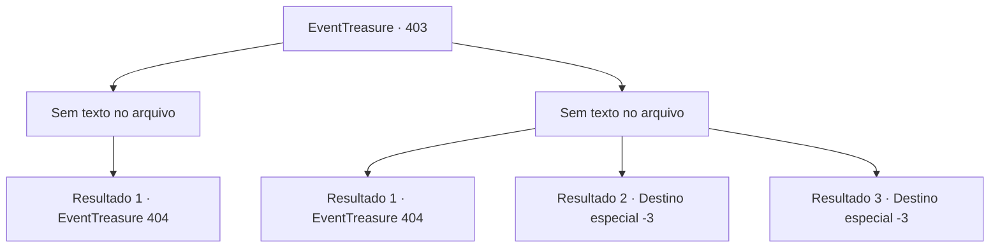

# Eventos de tesouro · 403

[Índice da tabela](index.md) · [Índice geral](../index.md)

ID: `pt:EventTreasure:403` · Fonte: `EventTreasure4` · Versão: 1.2.47.

Mapeamento estático dos arquivos; a disponibilidade e a execução dependem do estado da run.

## Texto do evento

*Sem texto no arquivo.*

## Dados de entrada

```json
{
  "id": 403,
  "grade": 1,
  "place": "",
  "required": ""
}
```

## Mapa das escolhas



## Escolhas e resultados

### Escolha 1

*Sem texto no arquivo; o papel dessa opção depende da interface do jogo.*

Requisitos e outros campos da escolha:

```json
{
  "required": ""
}
```

#### Resultado 1.1

O lobo do inverno cai em suas mãos, tornando-se um com o campo coberto de neve. A neve em turbilhão consome vorazmente seu corpo sem vida. Deixando o lobo para trás, você continua sua subida pela montanha. Eventualmente, você chega à entrada de uma caverna, onde o tremor da espada em sua mão se intensifica. A caverna não parece ter se formado naturalmente; parece que algum ser colossal a esculpiu deliberadamente. Ao entrar na caverna, você vê suas paredes revestidas de gelo com um leve tom azul. O gelo brilha intensamente, refletindo a luz que entra pelo teto desmoronado acima. Você avança mais na caverna. Logo, você se depara com o mestre deste covil: um Dragão Branco, conhecido como o Rei das Montanhas Nevadas. Seus olhos amarelos penetrantes brilham enquanto ele o observa atentamente.

Continuação registrada: [Evento 404](0404.md) na mesma tabela.

```json
{
  "required": "",
  "chance": "1",
  "nextEvent": 404,
  "type": 2,
  "reward": ""
}
```

### Escolha 2

*Sem texto no arquivo; o papel dessa opção depende da interface do jogo.*

Requisitos e outros campos da escolha:

```json
{
  "required": ""
}
```

#### Resultado 2.1

Você foge do lobo do inverno, buscando refúgio dentro de uma caverna. Assim que você entra, o lobo enfia o rabo, solta um som de gemido e foge. A caverna não parece ter se formado naturalmente; parece que algum ser colossal a esculpiu deliberadamente. Ao entrar na caverna, você vê suas paredes revestidas de gelo com um leve tom azul. O gelo brilha intensamente, refletindo a luz que entra pelo teto desmoronado acima. Você caminha mais para dentro da caverna. Logo, você se depara com o mestre deste covil: um Dragão Branco, conhecido como o Rei das Montanhas Nevadas. Seus olhos amarelos penetrantes brilham enquanto ele te observa atentamente.

Continuação registrada: [Evento 404](0404.md) na mesma tabela.

```json
{
  "required": "1_0_2|1_1_2",
  "chance": "1",
  "nextEvent": 404,
  "type": 2,
  "reward": "0_0_-1"
}
```

#### Resultado 2.2

Os dentes afiados do lobo do inverno cravam-se em seu pescoço. A neve branca imaculada rapidamente se torna carmesim com seu sangue. Embora o sangue jorre como uma cachoeira, o lobo ainda parece insatisfeito. Ele avança novamente, rasgando ferozmente seu pescoço. No final, você perde a consciência e cai no chão.

Continuação registrada: [Destino especial `-3`](../destinos-especiais.md).

```json
{
  "required": "2_0_2",
  "chance": "1",
  "nextEvent": -3,
  "type": 2,
  "reward": "0_0_-1"
}
```

#### Resultado 2.3

Os dentes afiados do lobo do inverno cravam-se em seu pescoço. A neve branca imaculada rapidamente se torna carmesim com seu sangue. Embora o sangue jorre como uma cachoeira, o lobo ainda parece insatisfeito. Ele avança novamente, rasgando ferozmente seu pescoço. No final, você perde a consciência e cai no chão.

Continuação registrada: [Destino especial `-3`](../destinos-especiais.md).

```json
{
  "required": "2_1_2",
  "chance": "1",
  "nextEvent": -3,
  "type": 2,
  "reward": "0_0_-1"
}
```

## Referências que chegam a este evento

- [Evento 402 · escolha 1 · resultado 2](0402.md#escolha-1)
- [Evento 402 · escolha 3 · resultado 1](0402.md#escolha-3)
