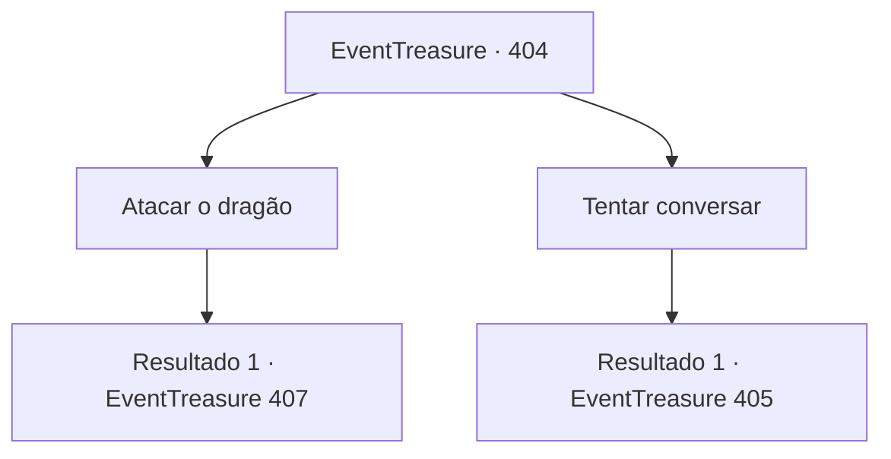

# Eventos de tesouro · 404

[Índice da tabela](index.md) · [Índice geral](../index.md)

ID: `pt:EventTreasure:404` · Fonte: `EventTreasure4` · Versão: 1.2.47.

Mapeamento estático dos arquivos; a disponibilidade e a execução dependem do estado da run.

## Texto do evento

*Sem texto no arquivo.*

## Dados de entrada

```json
{
  "id": 404,
  "grade": 1,
  "place": "",
  "required": ""
}
```

## Mapa das escolhas



## Escolhas e resultados

### Escolha 1

Atacar o dragão

Requisitos e outros campos da escolha:

```json
{
  "required": ""
}
```

#### Resultado 1.1

Você avança diretamente contra o Dragão Branco sem hesitação. Em resposta, os olhos do dragão brilham ameaçadoramente enquanto ele balança a pata dianteira em sua direção.

Continuação registrada: [Evento 407](0407.md) na mesma tabela.

```json
{
  "required": "",
  "chance": "1",
  "nextEvent": 407,
  "type": 2,
  "reward": "6_2_56",
  "place": 9
}
```

### Escolha 2

Tentar conversar

Requisitos e outros campos da escolha:

```json
{
  "required": ""
}
```

#### Resultado 2.1

Você fala com o dragão. O Dragão Branco olha para você com um brilho curioso nos olhos e diz, 

 "... Que problemático. O que você quer?"

 Você tira 'Ganjang' e pergunta ao dragão se ele já viu uma espada semelhante. O dragão examina a espada de perto antes de responder calmamente, 

 "Sim... há uma espada que chora sem parar. Mas o que tem isso?"


Continuação registrada: [Evento 405](0405.md) na mesma tabela.

```json
{
  "required": "",
  "chance": "1",
  "nextEvent": 405,
  "type": 2,
  "reward": ""
}
```

## Referências que chegam a este evento

- [Evento 402 · escolha 1 · resultado 1](0402.md#escolha-1)
- [Evento 402 · escolha 1 · resultado 3](0402.md#escolha-1)
- [Evento 402 · escolha 2 · resultado 1](0402.md#escolha-2)
- [Evento 403 · escolha 1 · resultado 1](0403.md#escolha-1)
- [Evento 403 · escolha 2 · resultado 1](0403.md#escolha-2)
