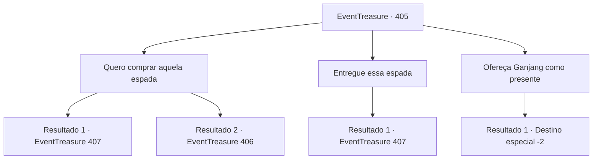

# Eventos de tesouro · 405

[Índice da tabela](index.md) · [Índice geral](../index.md)

ID: `pt:EventTreasure:405` · Fonte: `EventTreasure4` · Versão: 1.2.47.

Mapeamento estático dos arquivos; a disponibilidade e a execução dependem do estado da run.

## Texto do evento

*Sem texto no arquivo.*

## Dados de entrada

```json
{
  "id": 405,
  "grade": 1,
  "place": "",
  "required": ""
}
```

## Mapa das escolhas



## Escolhas e resultados

### Escolha 1

Quero comprar aquela espada

Requisitos e outros campos da escolha:

```json
{
  "required": ""
}
```

#### Resultado 1.1

Quando você expressa sua intenção de comprar a espada, o dragão te olha de cima a baixo antes de responder, 

 "... Você não parece alguém com riqueza para comprá-la. Já que você veio até aqui, pelo menos vou te aproveitar como um lanche!"

 Com essas palavras, o dragão abre suas mandíbulas enormes e libera seu ataque de sopro.

Continuação registrada: [Evento 407](0407.md) na mesma tabela.

```json
{
  "required": "21_4_4",
  "chance": "1",
  "nextEvent": 407,
  "type": 2,
  "reward": "6_2_56",
  "place": 9
}
```

#### Resultado 1.2

Quando você diz que quer comprar a espada, o dragão te estuda por um longo momento antes de explodir em risadas e dizer: 

 "Ha ha ha! Muito bem! Eu estava pensando em juntar algumas moedas de ouro—que sorte. Pague-me 1.000 moedas de ouro. Certamente, você consegue, não é?"


Continuação registrada: [Evento 406](0406.md) na mesma tabela.

```json
{
  "required": "20_4_4",
  "chance": "1",
  "nextEvent": 406,
  "type": 2,
  "reward": ""
}
```

### Escolha 2

Entregue essa espada

Requisitos e outros campos da escolha:

```json
{
  "required": ""
}
```

#### Resultado 2.1

Você ousadamente exige que o dragão entregue a espada. Em resposta, o Dragão Branco explode em risadas. 

 "Ha... Hahaha! Que tolo! Eu ia poupar você por pena do seu estado frágil... Mas isso é tudo que você vai conseguir de mim!"

 Com essas palavras, o dragão abre suas mandíbulas enormes e libera seu ataque de sopro.

Continuação registrada: [Evento 407](0407.md) na mesma tabela.

```json
{
  "required": "",
  "chance": "1",
  "nextEvent": 407,
  "type": 2,
  "reward": "6_2_56",
  "place": 9
}
```

### Escolha 3

Ofereça Ganjang como presente

Requisitos e outros campos da escolha:

```json
{
  "required": ""
}
```

#### Resultado 3.1

Você empunha 'Ganjang', estende-a para o dragão e pede que aceite a espada como um presente. O dragão examina a espada de perto e, aparentemente satisfeito, acena com a cabeça e diz: 

 "Nada mal. Um item bastante fino... Muito bem. Não sei por que você veio a estas montanhas nevadas, mas não me preocuparei mais com você. Vá."

 O dragão pega 'Ganjang' e a joga na pilha de bugigangas atrás dele. Nesse momento, uma voz familiar ecoa em sua mente. 

 "Oh... Oh, Makya! Finalmente, estamos reunidos!... Dou-te meus mais profundos agradecimentos, nobre viajante! Que teu caminho seja sempre abençoado com favor divino!"

 Você sente a voz de Ganjang gradualmente desaparecendo enquanto sai da caverna.

Continuação registrada: [Destino especial `-2`](../destinos-especiais.md).

```json
{
  "required": "",
  "chance": "1",
  "nextEvent": -2,
  "type": 2,
  "reward": "4_336_1|5_770_9|0_3_3"
}
```

## Referências que chegam a este evento

- [Evento 404 · escolha 2 · resultado 1](0404.md#escolha-2)
