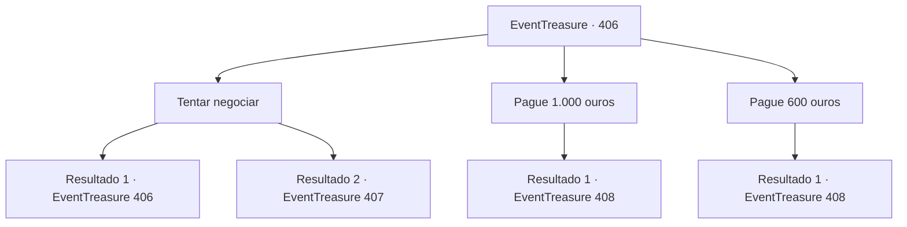

# Eventos de tesouro · 406

[Índice da tabela](index.md) · [Índice geral](../index.md)

ID: `pt:EventTreasure:406` · Fonte: `EventTreasure4` · Versão: 1.2.47.

Mapeamento estático dos arquivos; a disponibilidade e a execução dependem do estado da run.

## Texto do evento

*Sem texto no arquivo.*

## Dados de entrada

```json
{
  "id": 406,
  "grade": 1,
  "place": "",
  "required": ""
}
```

## Mapa das escolhas



## Escolhas e resultados

### Escolha 1

Tentar negociar

Requisitos e outros campos da escolha:

```json
{
  "required": "5_772_0"
}
```

#### Resultado 1.1

Você tenta negociar com o dragão. Suas palavras eloquentes e charme conseguem persuadir até mesmo o feroz Dragão Branco. 

 "Hmm... Muito bem, então. Apenas me pague 600 ouro."


Continuação registrada: [Evento 406](0406.md) na mesma tabela.

```json
{
  "required": "",
  "chance": "1|0_12_1",
  "nextEvent": 406,
  "type": 0,
  "reward": "5_772_1"
}
```

#### Resultado 1.2

Você tenta negociar com o dragão. No entanto, o feroz dragão parece profundamente ofendido pela sua tentativa. 

 "Que loucura! Eu estava inclinado a mostrar misericórdia, vendo você em um estado tão lamentável... Mas isso é tudo que você receberá de mim!"

 Com essas palavras, o dragão abre suas mandíbulas enormes e libera seu ataque de sopro.

Continuação registrada: [Evento 407](0407.md) na mesma tabela.

```json
{
  "required": "",
  "chance": "30",
  "nextEvent": 407,
  "type": 1,
  "reward": "6_2_56",
  "place": 9
}
```

### Escolha 2

Pague 1.000 ouros

Requisitos e outros campos da escolha:

```json
{
  "required": "1_4_1000|18_772_1"
}
```

#### Resultado 2.1

Você decide pagar 1.000 ouro para comprar a espada. O Dragão Branco, parecendo satisfeito, retorna à sua pilha de bugigangas e logo traz de volta uma espada, colocando-a diante de você. 

 "Aqui. Pegue."

 A espada parece idêntica a Ganjang, mas uma aura fraca e gelada emana dela. Ao pegar a espada, uma voz familiar ecoa em sua mente. 

 "Oh... Oh, Makya! Finalmente, estamos reunidos! Dou-te meus mais profundos agradecimentos... verdadeiramente, meus sinceros agradecimentos! Não sei como poderia retribuir essa gentileza tão graciosa..."

 Você guarda a espada e rapidamente sai do covil do dragão. Descendo a montanha, você ouve uma voz suave e elegante ressoar em sua mente. 

 "Muito obrigada por nos reunir novamente, a mim e ao meu marido."


Continuação registrada: [Evento 408](0408.md) na mesma tabela.

```json
{
  "required": "",
  "chance": "1",
  "nextEvent": 408,
  "type": 2,
  "reward": "3_337_1|5_770_9|0_4_-1000"
}
```

### Escolha 3

Pague 600 ouros

Requisitos e outros campos da escolha:

```json
{
  "required": "1_4_600|5_772_1"
}
```

#### Resultado 3.1

Você decide pagar 600 ouro para comprar a espada. O Dragão Branco, parecendo satisfeito, retorna à sua pilha de bugigangas e logo traz de volta uma espada, colocando-a diante de você. 

 "Aqui. Pegue."

 A espada parece idêntica a Ganjang, mas uma aura fraca e gelada emana dela. Ao pegar a espada, uma voz familiar ecoa em sua mente. 

 "Oh... Oh, Makya! Finalmente, estamos reunidos! Eu te dou meus mais profundos agradecimentos... verdadeiramente, meus sinceros agradecimentos! Não sei como poderia retribuir essa gentileza tão graciosa..."

 Você guarda a espada e rapidamente sai do covil do dragão. Descendo a montanha, você ouve uma voz suave e elegante ressoar em sua mente. 

 "Muito obrigado por nos reunir novamente, a mim e ao meu marido."


Continuação registrada: [Evento 408](0408.md) na mesma tabela.

```json
{
  "required": "",
  "chance": "1",
  "nextEvent": 408,
  "type": 2,
  "reward": "3_337_1|5_770_9|0_4_-600"
}
```

## Referências que chegam a este evento

- [Evento 405 · escolha 1 · resultado 2](0405.md#escolha-1)
- [Evento 406 · escolha 1 · resultado 1](0406.md#escolha-1)
