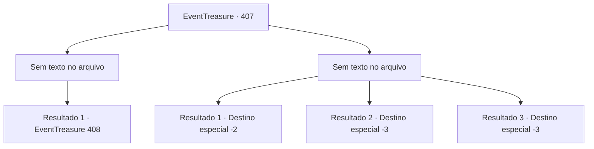

# Eventos de tesouro · 407

[Índice da tabela](index.md) · [Índice geral](../index.md)

ID: `pt:EventTreasure:407` · Fonte: `EventTreasure4` · Versão: 1.2.47.

Mapeamento estático dos arquivos; a disponibilidade e a execução dependem do estado da run.

## Texto do evento

*Sem texto no arquivo.*

## Dados de entrada

```json
{
  "id": 407,
  "grade": 1,
  "place": "",
  "required": ""
}
```

## Mapa das escolhas



## Escolhas e resultados

### Escolha 1

*Sem texto no arquivo; o papel dessa opção depende da interface do jogo.*

Requisitos e outros campos da escolha:

```json
{
  "required": ""
}
```

#### Resultado 1.1

De alguma forma, você consegue dominar o enfraquecido Dragão Branco. Em desespero, o dragão voa em direção ao teto da caverna, rompendo uma abertura por onde a luz entra e escapando. O impacto faz a caverna começar a desmoronar, mas você rapidamente vasculha a pilha de bugigangas do dragão e encontra uma espada que se assemelha a 'Ganjang'. Ao pegar a espada, uma voz familiar ecoa em sua mente. 

 "Oh... Oh, Makya! Finalmente, estamos reunidos! Dou-te minhas mais profundas graças... verdadeiramente, meus sinceros agradecimentos! Não sei como poderia retribuir essa bondade tão graciosa..."

 Você segura a espada e rapidamente sai do covil do dragão. Descendo a montanha, você ouve uma voz suave e elegante ressoar em sua mente. 

 "Muito obrigada por nos reunir, a mim e ao meu marido, novamente."


Continuação registrada: [Evento 408](0408.md) na mesma tabela.

```json
{
  "required": "",
  "chance": "1",
  "nextEvent": 408,
  "type": 2,
  "reward": "3_337_1|5_770_9"
}
```

### Escolha 2

*Sem texto no arquivo; o papel dessa opção depende da interface do jogo.*

Requisitos e outros campos da escolha:

```json
{
  "required": ""
}
```

#### Resultado 2.1

Quando a situação se voltou contra você, chamas irromperam da lâmina de Ganjang. O Dragão Branco ficou distraído com a exibição de fogo, permitindo que você escapasse em segurança do covil do dragão.

Continuação registrada: [Destino especial `-2`](../destinos-especiais.md).

```json
{
  "required": "1_0_2|1_1_2",
  "chance": "1",
  "nextEvent": -2,
  "type": 2,
  "reward": "4_336_1|5_770_9"
}
```

#### Resultado 2.2

Golpeado pela enorme cauda do dragão, você é arremessado violentamente contra a parede da caverna. Enquanto você permanece imóvel, o Dragão Branco olha para você com um sorriso cruel. 

 "Morra--!!"

 Com um rugido estrondoso, ele esmaga seu corpo com uma força aterrorizante.

Continuação registrada: [Destino especial `-3`](../destinos-especiais.md).

```json
{
  "required": "2_0_2",
  "chance": "1",
  "nextEvent": -3,
  "type": 2,
  "reward": "0_0_-1|0_1_-1"
}
```

#### Resultado 2.3

Golpeado pela enorme cauda do dragão, você é arremessado violentamente contra a parede da caverna. Enquanto você permanece imóvel, o Dragão Branco olha para você com um sorriso cruel. 

 "Morra--!!"

 Com um rugido estrondoso, ele esmaga seu corpo com uma força aterrorizante.

Continuação registrada: [Destino especial `-3`](../destinos-especiais.md).

```json
{
  "required": "2_1_2",
  "chance": "1",
  "nextEvent": -3,
  "type": 2,
  "reward": "0_0_-1|0_1_-1"
}
```

## Referências que chegam a este evento

- [Evento 404 · escolha 1 · resultado 1](0404.md#escolha-1)
- [Evento 405 · escolha 1 · resultado 1](0405.md#escolha-1)
- [Evento 405 · escolha 2 · resultado 1](0405.md#escolha-2)
- [Evento 406 · escolha 1 · resultado 2](0406.md#escolha-1)
