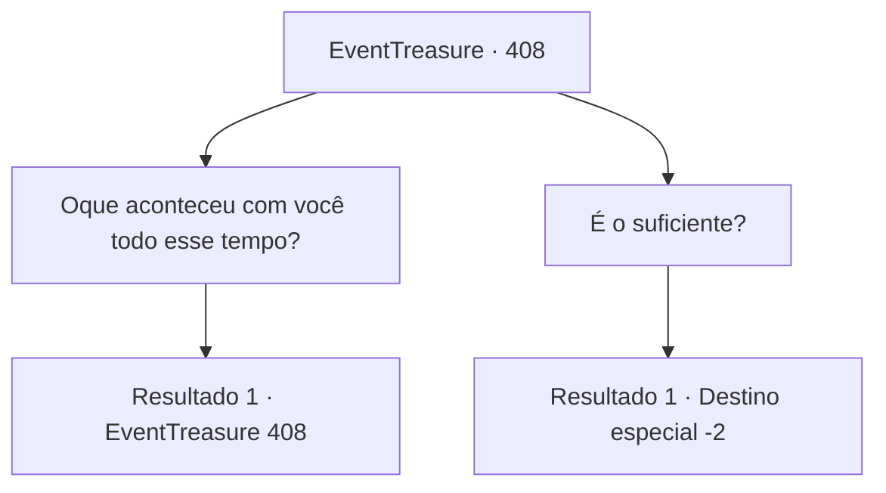

# Eventos de tesouro · 408

[Índice da tabela](index.md) · [Índice geral](../index.md)

ID: `pt:EventTreasure:408` · Fonte: `EventTreasure4` · Versão: 1.2.47.

Mapeamento estático dos arquivos; a disponibilidade e a execução dependem do estado da run.

## Texto do evento

*Sem texto no arquivo.*

## Dados de entrada

```json
{
  "id": 408,
  "grade": 1,
  "place": "",
  "required": ""
}
```

## Mapa das escolhas



## Escolhas e resultados

### Escolha 1

Oque aconteceu com você todo esse tempo?

Requisitos e outros campos da escolha:

```json
{
  "required": "5_773_0"
}
```

#### Resultado 1.1

Você pergunta a Makya o que aconteceu com ela durante todo esse tempo. 

 "É uma longa história, mas vou resumir para não te entediar. A pedido do meu marido, procurei esconder esta espada, 'Makya', onde ninguém jamais a encontraria."

 Makya explica que tentou esconder a espada dentro de um pinheiro atrás da aldeia. No entanto, ao sair da aldeia e subir uma colina, ela encontrou um bando de ladrões. No final, ela não teve escolha a não ser tirar a própria vida. 

 "Quando recobrei a consciência, por razões que não posso explicar, minha alma havia se ligado a esta espada."

 Ela diz que a partir de então, passou pelas mãos de muitos. Os ladrões travaram uma batalha sangrenta entre si por Makya, e o sobrevivente foi morto por um orc. O orc que reivindicou Makya foi posteriormente morto por um gigante de gelo, e o gigante de gelo, por sua vez, foi derrotado pelo Dragão Branco, que levou a espada. 

 "E assim, permaneci presa naquela caverna por todo esse tempo."


Continuação registrada: [Evento 408](0408.md) na mesma tabela.

```json
{
  "required": "",
  "chance": "1",
  "nextEvent": 408,
  "type": 2,
  "reward": "5_773_1"
}
```

### Escolha 2

É o suficiente?

Requisitos e outros campos da escolha:

```json
{
  "required": ""
}
```

#### Resultado 2.1

Em resposta à sua pergunta, Ganjang responde com uma voz trêmula, 

 "Obrigado. Finalmente, este arrependimento de longa data foi aliviado... tudo graças a você. Desejo-lhe a melhor sorte em sua jornada."

 Então, a voz suave de Makya segue, 

 "É hora de nos separarmos. Devemos voltar para onde pertencemos. Adeus..."

 Com essas palavras finais, as vozes de Ganjang e Makya desaparecem, nunca mais sendo ouvidas novamente.

Continuação registrada: [Destino especial `-2`](../destinos-especiais.md).

```json
{
  "required": "",
  "chance": "1",
  "nextEvent": -2,
  "type": 2,
  "reward": "5_770_9"
}
```

## Referências que chegam a este evento

- [Evento 406 · escolha 2 · resultado 1](0406.md#escolha-2)
- [Evento 406 · escolha 3 · resultado 1](0406.md#escolha-3)
- [Evento 407 · escolha 1 · resultado 1](0407.md#escolha-1)
- [Evento 408 · escolha 1 · resultado 1](0408.md#escolha-1)
