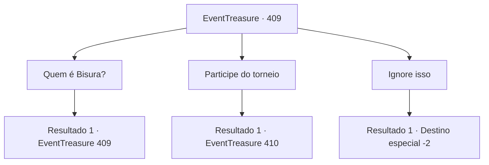

# Eventos de tesouro · 409

[Índice da tabela](index.md) · [Índice geral](../index.md)

ID: `pt:EventTreasure:409` · Fonte: `EventTreasure4` · Versão: 1.2.47.

Mapeamento estático dos arquivos; a disponibilidade e a execução dependem do estado da run.

## Texto do evento

Certa noite, ao pôr do sol, você descansava numa taverna sem nome em uma pequena aldeia, aliviando o cansaço do dia. O brilho acolhedor da lareira iluminava suavemente o interior da taverna, enquanto as risadas dispersas dos frequentadores e o tilintar dos copos criavam uma atmosfera tranquila.  Enquanto sorvia sua cerveja e olhava pela janela, você ouviu a conversa de um bando de mercenários na mesa de madeira ao seu lado.  

 "Você ficou sabendo? Dizem que vai haver um torneio na Arena de Rohone para homenagear Bisura."

 "Bisura... Ah, quer dizer o “Esmagador”?"

 "É. É para comemorá-lo — sob o pretexto de encontrar o suposto “Herdeiro de Bisura”. Ouvi dizer que o vencedor recebe um prêmio em dinheiro, além da maça que Bisura outrora empunhou."


## Dados de entrada

```json
{
  "id": 409,
  "grade": 2,
  "place": "",
  "required": "5_860_0|26_50_1|1_2_50"
}
```

## Mapa das escolhas



## Escolhas e resultados

### Escolha 1

Quem é Bisura?

Requisitos e outros campos da escolha:

```json
{
  "required": "5_861_0"
}
```

#### Resultado 1.1

Um dos mercenários de barba espessa pousou sua caneca de cerveja e respondeu à sua pergunta. 

 "Há cerca de dez anos, houve um campeão lendário de Romb que se aposentou."

  Ele acrescentou uma explicação sobre Romb. 

 "Talvez você já tenha ouvido falar — Romb é uma cidade de prazeres construída em penhascos à beira-mar, famosa por seu hipódromo e sua arena de duelos. Se você tiver a chance, deveria ir lá pessoalmente."

  Então, após dar outro gole na cerveja, ele continuou. 

 "Mas isso não vem ao caso. De todo modo, o homem conhecido como Bisura travou quarenta e dois combates antes de se aposentar, e é famoso por nunca ter perdido um sequer. Rohone é sua cidade natal, e ao que parece acabaram de construir lá um novo coliseu com o nome dele. Dizem que será desenvolvido como uma nova atração turística de Rohone."

  Enquanto os mercenários falavam, o taverneiro aproximou-se entre os clientes, e sua voz ganhou um tom nostálgico. 

 "Ah, sempre que o Esmagador tinha um combate, era um espetáculo de verdade! A arena de duelos ficava lotada até não sobrar um palmo de espaço. Gente vinha de longe só para testemunhar a cena eletrizante de sua maça estilhaçando as armaduras e os escudos dos inimigos, ou esmagando os crânios de monstros gigantes com um único golpe."


Continuação registrada: [Evento 409](0409.md) na mesma tabela.

```json
{
  "required": "",
  "chance": "1",
  "nextEvent": 409,
  "type": 2,
  "reward": "5_861_1"
}
```

### Escolha 2

Participe do torneio

Requisitos e outros campos da escolha:

```json
{
  "required": ""
}
```

#### Resultado 2.1

Você seguiu direto para a arena de Rohone. Após vários dias de viagem, você finalmente chegou a Rohone. Era uma bela cidade litorânea, suas margens delineadas por uma impressionante baía de areia preta de cinzas vulcânicas. De um lado da cidade, uma majestosa cachoeira trovejava dos penhascos para o mar abaixo, e seu bramido fresco atraía visitantes mesmo em tempos mais tranquilos. Mas agora as ruas estavam muito mais cheias do que o normal. Espectadores e competidores haviam vindo de todos os cantos para o Torneio Memorial de Bisura, lotando a cidade até o limite.  No coração de tudo, um novo anfiteatro colossal erguia-se acima do centro da cidade. Era o Coliseu de Bisura. |drawing_bisuraColosseum| Sua fachada de mármore branco era coroada por uma imponente estátua de Bisura empunhando sua maça, não deixando dúvidas de que aquele lugar fora construído para homenageá-lo. Ao redor da arena, incontáveis estandartes e flâmulas ondulavam ao vento, enquanto diante de seus portões se estendia uma longa fila de participantes esperançosos aguardando para se inscrever.

Continuação registrada: [Evento 410](0410.md) na mesma tabela.

```json
{
  "required": "",
  "chance": "1",
  "nextEvent": 410,
  "type": 2,
  "reward": ""
}
```

### Escolha 3

Ignore isso

Requisitos e outros campos da escolha:

```json
{
  "required": ""
}
```

#### Resultado 3.1

Você decidiu ignorar as histórias dos mercenários.

Continuação registrada: [Destino especial `-2`](../destinos-especiais.md).

```json
{
  "required": "",
  "chance": "1",
  "nextEvent": -2,
  "type": 2,
  "reward": "5_860_9"
}
```

## Referências que chegam a este evento

- [Evento 409 · escolha 1 · resultado 1](0409.md#escolha-1)
