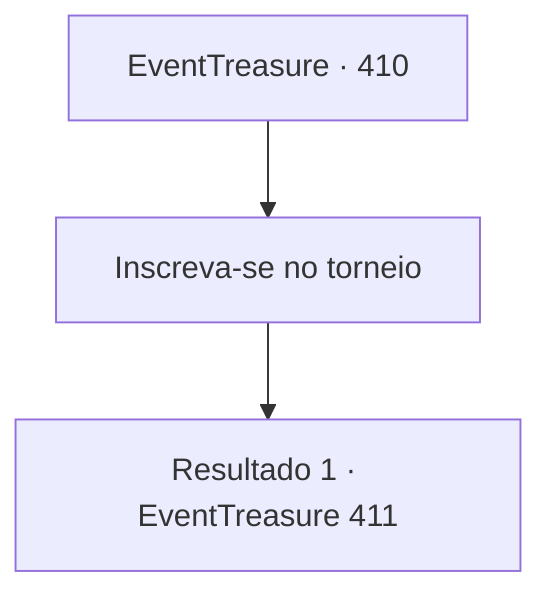

# Eventos de tesouro · 410

[Índice da tabela](index.md) · [Índice geral](../index.md)

ID: `pt:EventTreasure:410` · Fonte: `EventTreasure4` · Versão: 1.2.47.

Mapeamento estático dos arquivos; a disponibilidade e a execução dependem do estado da run.

## Texto do evento

*Sem texto no arquivo.*

## Dados de entrada

```json
{
  "id": 410,
  "grade": 1,
  "place": "",
  "required": ""
}
```

## Mapa das escolhas



## Escolhas e resultados

### Escolha 1

Inscreva-se no torneio

Requisitos e outros campos da escolha:

```json
{
  "required": ""
}
```

#### Resultado 1.1

Após uma longa espera para concluir sua inscrição, você foi conduzido ao interior do coliseu junto com os outros participantes. No centro da arena, um campo de testes havia sido preparado. 

 "Participantes, obrigado pela paciência. O torneio começará agora!"

 A voz retumbante do anfitrião ecoou por toda a arena. 

 "A primeira prova é um teste conhecido como “Gada”, a antiga disciplina da maça!"

  No campo de testes, maças enormes — tão pesadas que exigiam as duas mãos para erguer — estavam dispostas em fila. 

 "As regras são simples. Usando a maça fornecida, você deve executar a sequência prescrita de movimentos sem falhas. Sua resistência, precisão e controle serão avaliados em conjunto."

  Concluída a explicação, o juiz fez uma demonstração. Ele ergueu a maça bem acima da cabeça, girou-a suavemente de um lado para o outro, varreu-a ao redor do corpo e, por fim, abaixou-a com cuidado sobre um ponto preciso.

Continuação registrada: [Evento 411](0411.md) na mesma tabela.

```json
{
  "required": "",
  "chance": "1",
  "nextEvent": 411,
  "type": 2,
  "reward": ""
}
```

## Referências que chegam a este evento

- [Evento 409 · escolha 2 · resultado 1](0409.md#escolha-2)
