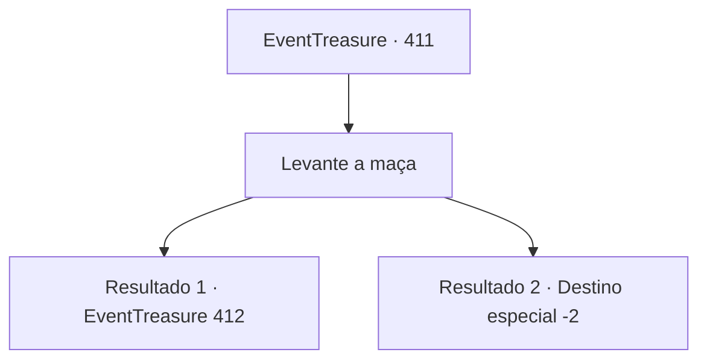

# Eventos de tesouro · 411

[Índice da tabela](index.md) · [Índice geral](../index.md)

ID: `pt:EventTreasure:411` · Fonte: `EventTreasure4` · Versão: 1.2.47.

Mapeamento estático dos arquivos; a disponibilidade e a execução dependem do estado da run.

## Texto do evento

*Sem texto no arquivo.*

## Dados de entrada

```json
{
  "id": 411,
  "grade": 1,
  "place": "",
  "required": ""
}
```

## Mapa das escolhas



## Escolhas e resultados

### Escolha 1

Levante a maça

Requisitos e outros campos da escolha:

```json
{
  "required": ""
}
```

#### Resultado 1.1

Ao erguer a maça, seu peso pesou nos seus braços mais do que você esperava. Mas, para você, não foi uma tarefa tão difícil. Inspirando profundamente, você ergueu a maça bem acima da cabeça, girou-a suavemente de um lado para o outro para manter o equilíbrio e a fez varrer ao redor do corpo em sequência.  O juiz observava seus movimentos com um olhar atento, enquanto alguns dos outros competidores já fraquejavam — deixando cair a pesada maça, cambaleando ou até desabando sob seu peso.  Quando você completou o movimento final sem falhas, o juiz declarou: 

 "Parabéns! Você está classificado(a) para a próxima fase!"

  Com isso, irromperam aplausos da plateia que assistia à prova. Você, junto com alguns outros que haviam sido aprovados, foi conduzido pela equipe até a sala de espera.

Continuação registrada: [Evento 412](0412.md) na mesma tabela.

```json
{
  "required": "",
  "chance": "1|0_5_1|0_13_1",
  "nextEvent": 412,
  "type": 0,
  "reward": ""
}
```

#### Resultado 1.2

Ao erguer a maça, o peso pesou nos seus braços mais do que você havia esperado. Inspirando profundamente, você levantou o macebell acima da cabeça, teve dificuldade para girá-lo de um lado para o outro e o conduziu ao redor do corpo em sequência.  Mas então, incapaz de suportar o peso, você perdeu o equilíbrio e caiu. 

 "Ah… que pena…"

 Um suspiro de decepção percorreu as arquibancadas enquanto os espectadores observavam.  O juiz avançou rapidamente e anunciou sua eliminação. 

 "Lamentavelmente, você está desclassificado! Todos os participantes eliminados, por favor, dirijam-se à saída à direita."

  Junto com os outros competidores desclassificados, você deixou o coliseu.

Continuação registrada: [Destino especial `-2`](../destinos-especiais.md).

```json
{
  "required": "",
  "chance": "30",
  "nextEvent": -2,
  "type": 1,
  "reward": "5_860_9"
}
```

## Referências que chegam a este evento

- [Evento 410 · escolha 1 · resultado 1](0410.md#escolha-1)
