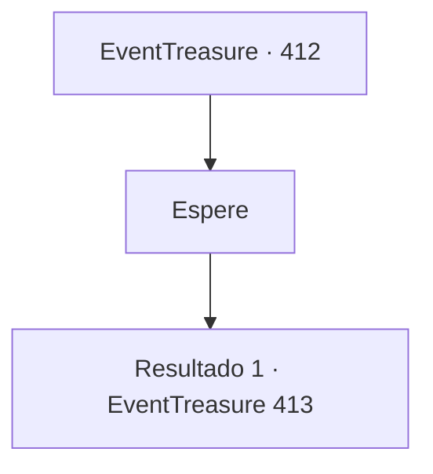

# Eventos de tesouro · 412

[Índice da tabela](index.md) · [Índice geral](../index.md)

ID: `pt:EventTreasure:412` · Fonte: `EventTreasure4` · Versão: 1.2.47.

Mapeamento estático dos arquivos; a disponibilidade e a execução dependem do estado da run.

## Texto do evento

*Sem texto no arquivo.*

## Dados de entrada

```json
{
  "id": 412,
  "grade": 1,
  "place": "",
  "required": ""
}
```

## Mapa das escolhas



## Escolhas e resultados

### Escolha 1

Espere

Requisitos e outros campos da escolha:

```json
{
  "required": ""
}
```

#### Resultado 1.1

Você se sentou na sala de espera, fazendo uma breve pausa. Ao seu redor, aventureiros de muitas terras diferentes alongavam o corpo em preparação. Não demorou para que um atendente entrasse. 

 "Os preparativos para a segunda rodada estão concluídos. Competidores, por favor, dirijam-se em ordem."

  Um a um, os participantes começaram a sair em direção à arena, guiados pela equipe. Você os seguiu — apenas para ser recebido pelo olhar de incontáveis espectadores e pela figura imponente de um Golem de Pedra.  

 "Agora, nesta etapa, vocês enfrentarão o Golem de Pedra!"

 O anúncio do apresentador ressoou. 

 "Cada um de vocês receberá o mesmo tipo de maça. Com esta arma, vocês devem derrubar o golem. Trata-se de uma maça de aço padrão, do mesmo tipo que um dia foi empunhada por Bisura, e o objetivo desta prova é testar apenas a habilidade! As armas devem ser devolvidas quando a partida terminar."

  Mesmo enquanto suas palavras chegavam ao fim, o golem começou a avançar na sua direção.

Continuação registrada: [Evento 413](0413.md) na mesma tabela.

```json
{
  "required": "",
  "chance": "1",
  "nextEvent": 413,
  "type": 2,
  "reward": "16_370_1|6_2_15",
  "place": 11
}
```

## Referências que chegam a este evento

- [Evento 411 · escolha 1 · resultado 1](0411.md#escolha-1)
