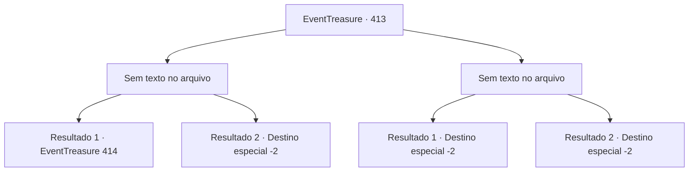

# Eventos de tesouro · 413

[Índice da tabela](index.md) · [Índice geral](../index.md)

ID: `pt:EventTreasure:413` · Fonte: `EventTreasure4` · Versão: 1.2.47.

Mapeamento estático dos arquivos; a disponibilidade e a execução dependem do estado da run.

## Texto do evento

*Sem texto no arquivo.*

## Dados de entrada

```json
{
  "id": 413,
  "grade": 1,
  "place": "",
  "required": ""
}
```

## Mapa das escolhas



## Escolhas e resultados

### Escolha 1

*Sem texto no arquivo; o papel dessa opção depende da interface do jogo.*

Requisitos e outros campos da escolha:

```json
{
  "required": ""
}
```

#### Resultado 1.1

Após várias trocas de golpes, o momento finalmente chegou. Quando o golem ergueu ambos os braços bem acima da cabeça para desferir um golpe esmagador, você aproveitou a abertura sem hesitar. Você brandiu sua maça com toda a força, acertando em cheio a articulação do joelho.  Crack—!  Com o seu golpe decisivo, uma fratura enorme se abriu pelo corpo do Golem de Pedra e, no instante seguinte, ele desabou, espalhando nuvens de poeira e fragmentos de pedra. Os espectadores irromperam em vivas e aplausos estrondosos ao ver a cena. Você enxugou o suor da testa e olhou ao redor. Outros competidores ainda travavam uma luta feroz contra seus golems, e você voltou para a sala de espera para descansar.

Continuação registrada: [Evento 414](0414.md) na mesma tabela.

```json
{
  "required": "23_11_1",
  "chance": "1",
  "nextEvent": 414,
  "type": 2,
  "reward": ""
}
```

#### Resultado 1.2

O combate foi interrompido, e o árbitro correu para bloquear seu caminho. 

 "Pare! Você não usou a arma designada, portanto está desclassificado."

 A multidão vaiou, e você foi expulso da arena.

Continuação registrada: [Destino especial `-2`](../destinos-especiais.md).

```json
{
  "required": "24_11_1",
  "chance": "1",
  "nextEvent": -2,
  "type": 2,
  "reward": "5_860_9"
}
```

### Escolha 2

*Sem texto no arquivo; o papel dessa opção depende da interface do jogo.*

Requisitos e outros campos da escolha:

```json
{
  "required": ""
}
```

#### Resultado 2.1

Você lutou ferozmente contra o Golem de Pedra, mas o desfecho não foi a seu favor. O punho pesado e maciço da criatura atingiu você em cheio, e você saiu rolando pelo chão de terra. De bruços, você cuspiu uma mistura desagradável de saliva e bile, e, ao ver aquilo, o juiz encerrou a luta. 

 "Isso é tudo para esta prova. Bem lutado."

  Era a declaração do seu fracasso. Enxugando o suor da testa, você olhou ao redor. Os outros competidores ainda travavam uma batalha desesperada com seus golems, enquanto você deixava a arena para trás, com o rugido da multidão ecoando às suas costas.

Continuação registrada: [Destino especial `-2`](../destinos-especiais.md).

```json
{
  "required": "23_11_1",
  "chance": "1",
  "nextEvent": -2,
  "type": 2,
  "reward": "5_860_9"
}
```

#### Resultado 2.2

O combate foi interrompido, e o juiz correu para bloquear seu caminho. 

 "Pare! Você não utilizou a arma designada—portanto, está desclassificado."

 A multidão explodiu em vaias, e você foi expulso da arena.

Continuação registrada: [Destino especial `-2`](../destinos-especiais.md).

```json
{
  "required": "24_11_1",
  "chance": "1",
  "nextEvent": -2,
  "type": 2,
  "reward": "5_860_9"
}
```

## Referências que chegam a este evento

- [Evento 412 · escolha 1 · resultado 1](0412.md#escolha-1)
