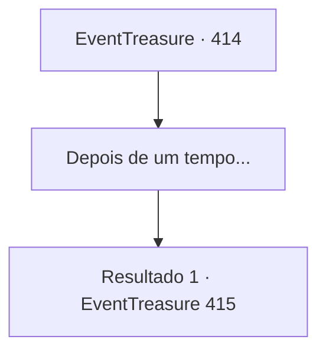

# Eventos de tesouro · 414

[Índice da tabela](index.md) · [Índice geral](../index.md)

ID: `pt:EventTreasure:414` · Fonte: `EventTreasure4` · Versão: 1.2.47.

Mapeamento estático dos arquivos; a disponibilidade e a execução dependem do estado da run.

## Texto do evento

*Sem texto no arquivo.*

## Dados de entrada

```json
{
  "id": 414,
  "grade": 1,
  "place": "",
  "required": ""
}
```

## Mapa das escolhas



## Escolhas e resultados

### Escolha 1

Depois de um tempo...

Requisitos e outros campos da escolha:

```json
{
  "required": ""
}
```

#### Resultado 1.1

Depois que a segunda rodada terminou, restava apenas a prova final. A última rodada era um duelo um contra um contra outro concorrente que também havia derrotado os golens.  Seu oponente era um guerreiro imponente do norte. Ele tinha quase dois metros de altura, com porte musculoso e longa barba — a própria imagem de um lutador do norte. 

 "Meu nome é Grimbar. Venho da tribo Martelo de Gelo do norte."

 Ele se apresentou enquanto segurava sua maça com firmeza.  Então o juiz começou a explicar as regras. 

 "Você deve continuar usando a arma que lhe foi dada anteriormente. E é proibido matar intencionalmente o seu oponente."

  Com a explicação encerrada, o juiz recuou e bradou: 

 "Comecem!"

  Quase antes que as palavras deixassem seus lábios, Grimbar investiu diretamente contra você.

Continuação registrada: [Evento 415](0415.md) na mesma tabela.

```json
{
  "required": "",
  "chance": "1",
  "nextEvent": 415,
  "type": 2,
  "reward": "6_0_194",
  "place": 11
}
```

## Referências que chegam a este evento

- [Evento 413 · escolha 1 · resultado 1](0413.md#escolha-1)
