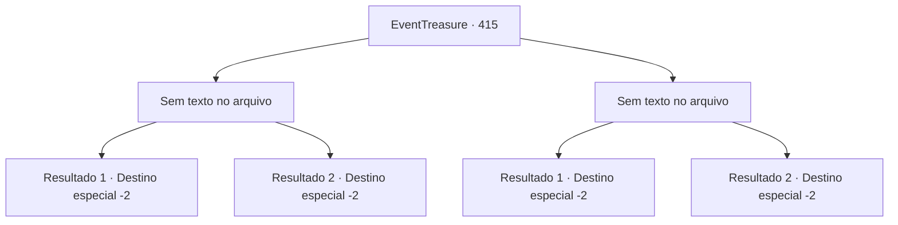

# Eventos de tesouro · 415

[Índice da tabela](index.md) · [Índice geral](../index.md)

ID: `pt:EventTreasure:415` · Fonte: `EventTreasure4` · Versão: 1.2.47.

Mapeamento estático dos arquivos; a disponibilidade e a execução dependem do estado da run.

## Texto do evento

*Sem texto no arquivo.*

## Dados de entrada

```json
{
  "id": 415,
  "grade": 1,
  "place": "",
  "required": ""
}
```

## Mapa das escolhas



## Escolhas e resultados

### Escolha 1

*Sem texto no arquivo; o papel dessa opção depende da interface do jogo.*

Requisitos e outros campos da escolha:

```json
{
  "required": ""
}
```

#### Resultado 1.1

Um confronto feroz se desenrolou, com nenhum dos lados cedendo um centímetro. Grimbar, um guerreiro experiente, pressionou você com uma variedade de padrões de ataque, mas você rebateu cada um com firmeza, recorrendo a toda a experiência que havia acumulado até agora. Aproveitando uma abertura, você o atingiu com força no flanco.  “Guhk—!” Com um breve grito, Grimbar caiu sobre um joelho, e o assistente correu para declarar sua vitória. 

 "O campeão do Torneio de Bisura foi decidido. O vencedor é {1}!"

  Aplausos e aclamações ensurdecedores irromperam das arquibancadas. <link=shake>

 "Uooooooh--!!"

</link>  Em meio à estrondosa ovação da multidão, você estendeu a mão a Grimbar. Com um sorriso amargo, ele a segurou e se levantou. 

 "Uf… hah… Foi uma ótima luta."

  Enquanto isso, os assistentes trouxeram um grande baú e o colocaram diante de você. 

 "Parabéns. Você herdou o título de “Esmagador”, sucessor de Bisura. Aqui está uma arma do mesmo tipo que ele empunhava. Por favor, aceite-a."

  Você abriu o baú e ergueu a maça bem alto, sentindo como se a própria força de Bisura fluísse para dentro de você. Ao verem isso, o coliseu irrompeu em aplausos explosivos.  Após receber sua recompensa, você então deixou a arena.

Continuação registrada: [Destino especial `-2`](../destinos-especiais.md).

```json
{
  "required": "23_11_1",
  "chance": "1",
  "nextEvent": -2,
  "type": 2,
  "reward": "5_860_9|27_59_1|0_4_200|4_370_1|3_371_1"
}
```

#### Resultado 1.2

O combate foi interrompido, e o juiz correu para bloquear seu caminho. 

 "Pare! Você não usou a arma designada, portanto está desclassificado."

 A multidão vaiou, e você foi expulso da arena.

Continuação registrada: [Destino especial `-2`](../destinos-especiais.md).

```json
{
  "required": "24_11_1",
  "chance": "1",
  "nextEvent": -2,
  "type": 2,
  "reward": "5_860_9"
}
```

### Escolha 2

*Sem texto no arquivo; o papel dessa opção depende da interface do jogo.*

Requisitos e outros campos da escolha:

```json
{
  "required": ""
}
```

#### Resultado 2.1

Travou-se um confronto feroz, e nenhum dos lados cedeu. Grimbar, um guerreiro experiente, pressionou você com uma ampla variedade de padrões de ataque, e, no fim, você caiu de joelhos diante dele.  

 "Combate encerrado!"

 Um assistente correu para declarar a vitória de Grimbar. 

 "O campeão do Torneio de Bisura foi decidido. O vencedor é Grimbar!"

  Das arquibancadas irrompeu um estrondoso clamor de vivas e aplausos. <link=shake>

 "Uoooooou--!!"

</link>  Grimbar ergueu ambos os braços bem alto, correspondendo com vigor à ovação desenfreada da multidão. Seu rosto brilhava com a alegria da vitória e a satisfação de ter sua força verdadeiramente reconhecida.  Então ele veio até você, estendeu a mão e ajudou você a ficar de pé. 

 "Foi um excelente combate! Graças a você, esta vitória vale ainda mais."

  Enquanto isso, os assistentes trouxeram um pequeno baú e o colocaram diante de você. 

 "Boa luta. Aqui está o prêmio destinado ao segundo colocado."

  Você abriu o baú com cuidado e recebeu uma quantia generosa de ouro em seu interior. Por fim, você curvou-se aos espectadores em agradecimento e, em silêncio, deixou a arena, carregando consigo o peso agridoce da derrota.

Continuação registrada: [Destino especial `-2`](../destinos-especiais.md).

```json
{
  "required": "23_11_1",
  "chance": "1",
  "nextEvent": -2,
  "type": 2,
  "reward": "5_860_9|0_4_150"
}
```

#### Resultado 2.2

O combate foi interrompido, e o juiz entrou apressado para bloquear o seu caminho. 

 "Pare! Você não usou a arma designada, portanto está desclassificado."

 A multidão vaiou, e você foi expulso da arena.

Continuação registrada: [Destino especial `-2`](../destinos-especiais.md).

```json
{
  "required": "24_11_1",
  "chance": "1",
  "nextEvent": -2,
  "type": 2,
  "reward": "5_860_9"
}
```

## Referências que chegam a este evento

- [Evento 414 · escolha 1 · resultado 1](0414.md#escolha-1)
