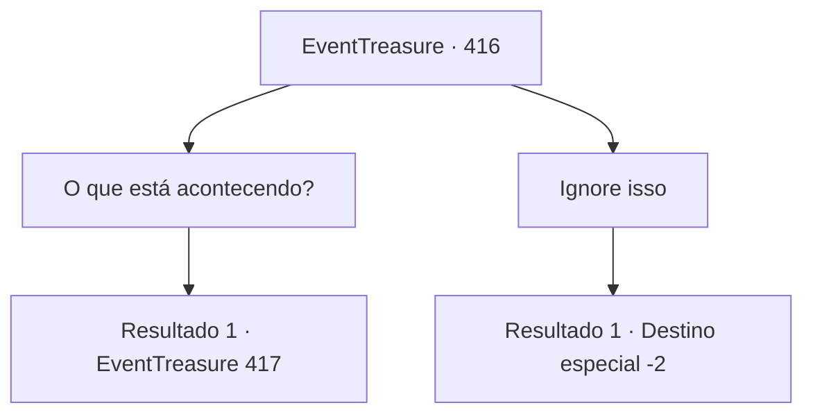

# Eventos de tesouro · 416

[Índice da tabela](index.md) · [Índice geral](../index.md)

ID: `pt:EventTreasure:416` · Fonte: `EventTreasure4` · Versão: 1.2.47.

Mapeamento estático dos arquivos; a disponibilidade e a execução dependem do estado da run.

## Texto do evento

Quando você chegou à pequena vila litorânea de 'Blue Coast', todo o lugar estava envolto em uma atmosfera sombria e pesada. Onde normalmente deveria haver um animado mercado de peixes e lojas movimentadas, apenas estabelecimentos de portas fechadas permaneciam em silêncio. Na praça central, aldeões com expressões preocupadas haviam se reunido, e, diante deles, um idoso — provavelmente o chefe da vila — falava com uma voz cheia de desespero. 

 "Por favor, parem… Se isso continuar, todos nós vamos morrer…!"


## Dados de entrada

```json
{
  "id": 416,
  "grade": 2,
  "place": "",
  "required": "5_862_0|1_2_50|26_47_1"
}
```

## Mapa das escolhas



## Escolhas e resultados

### Escolha 1

O que está acontecendo?

Requisitos e outros campos da escolha:

```json
{
  "required": ""
}
```

#### Resultado 1.1

Quando você se aproximou e fez uma pergunta ao ancião, ele respondeu como se estivesse esperando por alguém. 

 "Ai, meu Deus, a este ritmo nossa aldeia está condenada! Há uma semana inteira, tempestades implacáveis e raios vêm nos castigando…!"

  Ele acrescentou que a maioria dos aldeões tirava seu sustento da pesca, o que tornava a situação ainda mais grave. Agarrando-se a você quase em desespero, ele continuou: 

 "Há apenas uma semana, nada disso estava acontecendo. Tempestades vinham de vez em quando, mas nunca um raio havia atingido a própria aldeia."

  Nesse momento, outra mulher interveio para dar sequência às palavras do ancião. 

 "Mas então, há seis dias, raios começaram a cair por toda a aldeia!"


Continuação registrada: [Evento 417](0417.md) na mesma tabela.

```json
{
  "required": "",
  "chance": "1",
  "nextEvent": 417,
  "type": 2,
  "reward": ""
}
```

### Escolha 2

Ignore isso

Requisitos e outros campos da escolha:

```json
{
  "required": ""
}
```

#### Resultado 2.1

Você ignorou a voz desesperada do ancião e virou as costas, deixando a aldeia para trás.

Continuação registrada: [Destino especial `-2`](../destinos-especiais.md).

```json
{
  "required": "",
  "chance": "1",
  "nextEvent": -2,
  "type": 2,
  "reward": "5_862_9"
}
```

## Referências que chegam a este evento

Nenhum `nextEvent` positivo da mesma tabela aponta para este nó. Isso não prova que seja inacessível: sorteio e estado de história podem selecioná-lo.

