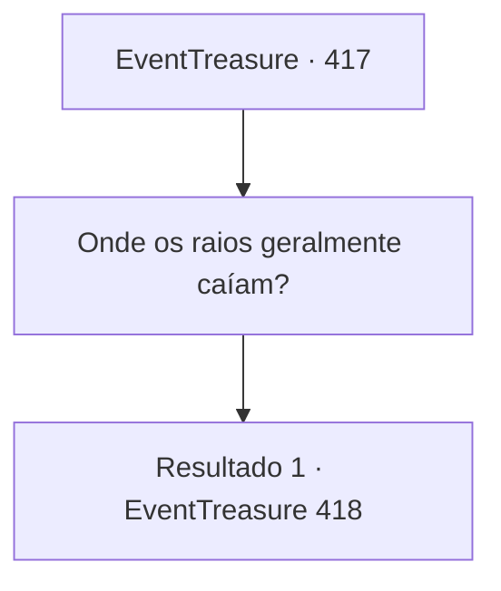

# Eventos de tesouro · 417

[Índice da tabela](index.md) · [Índice geral](../index.md)

ID: `pt:EventTreasure:417` · Fonte: `EventTreasure4` · Versão: 1.2.47.

Mapeamento estático dos arquivos; a disponibilidade e a execução dependem do estado da run.

## Texto do evento

*Sem texto no arquivo.*

## Dados de entrada

```json
{
  "id": 417,
  "grade": 1,
  "place": "",
  "required": ""
}
```

## Mapa das escolhas



## Escolhas e resultados

### Escolha 1

Onde os raios geralmente caíam?

Requisitos e outros campos da escolha:

```json
{
  "required": ""
}
```

#### Resultado 1.1

À sua pergunta, a mulher respondeu. 

 "Havia um grande rochedo nos penhascos acima da nossa aldeia. Os raios sempre atingiam aquela rocha no topo."

  Então um pescador que estava ao lado dela se manifestou. 

 "Bem… aquele rochedo foi destruído."

 Antes que você pudesse sequer perguntar por quê, ele acrescentou apressadamente, em tom defensivo: 

 "Achamos que era a rocha que atraía os raios…"

  O ancião então respondeu às suas palavras. 

 "De qualquer forma, o que está feito, está feito. Precisamos encontrar uma maneira de resolver isso."


Continuação registrada: [Evento 418](0418.md) na mesma tabela.

```json
{
  "required": "",
  "chance": "1",
  "nextEvent": 418,
  "type": 2,
  "reward": ""
}
```

## Referências que chegam a este evento

- [Evento 416 · escolha 1 · resultado 1](0416.md#escolha-1)
