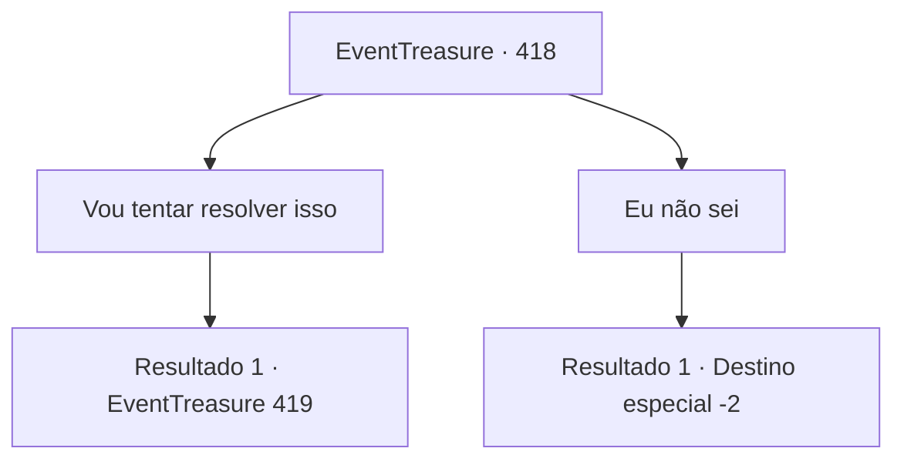

# Eventos de tesouro · 418

[Índice da tabela](index.md) · [Índice geral](../index.md)

ID: `pt:EventTreasure:418` · Fonte: `EventTreasure4` · Versão: 1.2.47.

Mapeamento estático dos arquivos; a disponibilidade e a execução dependem do estado da run.

## Texto do evento

*Sem texto no arquivo.*

## Dados de entrada

```json
{
  "id": 418,
  "grade": 1,
  "place": "",
  "required": ""
}
```

## Mapa das escolhas



## Escolhas e resultados

### Escolha 1

Vou tentar resolver isso

Requisitos e outros campos da escolha:

```json
{
  "required": "1_7_4"
}
```

#### Resultado 1.1

Quando você disse que tentaria resolver o problema, os rostos dos aldeões se iluminaram de alívio. 

 "Se você fizer isso, a aldeia certamente o recompensará. Eu prometo."

 O ancião falou, e os outros assentiram em concordância.  Segundo disseram, o pedregulho devia ter funcionado como uma espécie de para-raios. Mas, sem ele, os relâmpagos agora atingiam a aldeia diretamente.  Você decidiu ver o lugar onde o pedregulho ficara, e, tendo o ancião como guia, você começou a subir o acidentado caminho de montanha atrás da aldeia.  Quanto mais alto você ia, mais forte o vento ficava, e pesadas nuvens de tempestade comprimiam-se sobre a cabeça. 

 <link=shake>‘Rrrrumble… K-KRAAACK!’</link> 

 Trovoadas e relâmpagos ribombavam repetidas vezes nas proximidades, como se o próprio céu estivesse em fúria.  Quanto mais você se aproximava do penhasco, mais parecia que o próprio ar estava carregado de eletricidade. Seu cabelo se arrepiava, e um formigamento agudo picava constantemente sua pele.  

 "Eu... eu não posso ir mais adiante."

 O ancião, tremendo de medo, já não conseguia firmar as pernas e desabou onde estava.

Continuação registrada: [Evento 419](0419.md) na mesma tabela.

```json
{
  "required": "",
  "chance": "1",
  "nextEvent": 419,
  "type": 2,
  "reward": ""
}
```

### Escolha 2

Eu não sei

Requisitos e outros campos da escolha:

```json
{
  "required": ""
}
```

#### Resultado 2.1

Você escolheu não se envolver no assunto. Os aldeões começaram a se remexer ansiosamente, murmurando entre si sobre como teriam de encontrar uma maneira de resolver isso por conta própria. Sem lhes dar atenção, você deixou a aldeia para trás.

Continuação registrada: [Destino especial `-2`](../destinos-especiais.md).

```json
{
  "required": "",
  "chance": "1",
  "nextEvent": -2,
  "type": 2,
  "reward": "5_862_9"
}
```

## Referências que chegam a este evento

- [Evento 417 · escolha 1 · resultado 1](0417.md#escolha-1)
