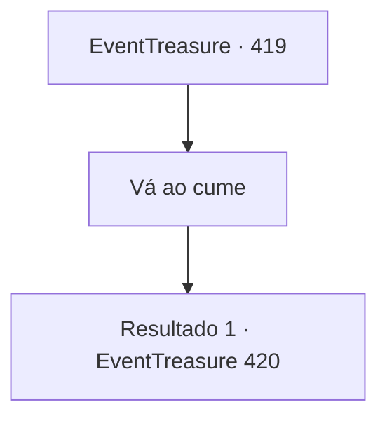

# Eventos de tesouro · 419

[Índice da tabela](index.md) · [Índice geral](../index.md)

ID: `pt:EventTreasure:419` · Fonte: `EventTreasure4` · Versão: 1.2.47.

Mapeamento estático dos arquivos; a disponibilidade e a execução dependem do estado da run.

## Texto do evento

*Sem texto no arquivo.*

## Dados de entrada

```json
{
  "id": 419,
  "grade": 1,
  "place": "",
  "required": ""
}
```

## Mapa das escolhas



## Escolhas e resultados

### Escolha 1

Vá ao cume

Requisitos e outros campos da escolha:

```json
{
  "required": ""
}
```

#### Resultado 1.1

Você deixou o ancião para trás e seguiu a sós até o topo do penhasco. Lá, você descobriu os restos despedaçados do rochedo. Antes uma formação maciça, agora jazia quebrado em fragmentos espalhados, e entre os pedaços reluziam vestígios de minério metálico.  Então, levada pelo vento, uma voz chegou aos seus ouvidos. 

 "Você… você tirou de mim o meu amigo…"

  Num clarão de relâmpago, ele surgiu— um espírito formado de vento, nuvem e trovão. Relâmpagos ardiam em seus olhos, enquanto ventos selvagens rodopiavam ao redor de seu corpo, faiscando com corrente crepitante.  

 "Por centenas de anos… por séculos, aquela pedra foi minha única companheira!"

  A fúria e a dor do espírito sacudiram toda a encosta do penhasco.

Continuação registrada: [Evento 420](0420.md) na mesma tabela.

```json
{
  "required": "",
  "chance": "1",
  "nextEvent": 420,
  "type": 2,
  "reward": ""
}
```

## Referências que chegam a este evento

- [Evento 418 · escolha 1 · resultado 1](0418.md#escolha-1)
