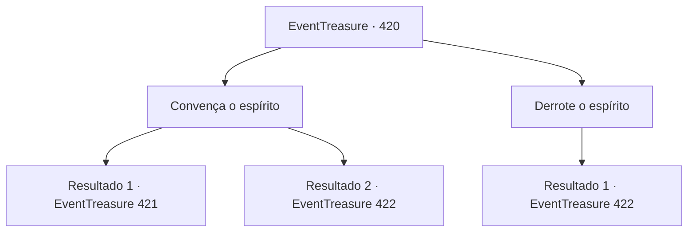

# Eventos de tesouro · 420

[Índice da tabela](index.md) · [Índice geral](../index.md)

ID: `pt:EventTreasure:420` · Fonte: `EventTreasure4` · Versão: 1.2.47.

Mapeamento estático dos arquivos; a disponibilidade e a execução dependem do estado da run.

## Texto do evento

*Sem texto no arquivo.*

## Dados de entrada

```json
{
  "id": 420,
  "grade": 1,
  "place": "",
  "required": ""
}
```

## Mapa das escolhas



## Escolhas e resultados

### Escolha 1

Convença o espírito

Requisitos e outros campos da escolha:

```json
{
  "required": ""
}
```

#### Resultado 1.1

Você tentou entrar em contato com o espírito com sua afinidade natural, e conseguiu acalmar sua fúria por um breve momento. 

 "Você tirou de mim quem eu mais estimava…"

 Você explicou que o que aconteceu foi resultado de um mal-entendido dos moradores da aldeia. Que eles haviam destruído a rocha não por maldade, mas por ignorância. O espírito rosnou enquanto ouvia suas palavras. 

 "Mesmo assim… meu amigo nunca voltará…"


Continuação registrada: [Evento 421](0421.md) na mesma tabela.

```json
{
  "required": "",
  "chance": "1|0_12_1",
  "nextEvent": 421,
  "type": 0,
  "reward": ""
}
```

#### Resultado 1.2


 "Você tirou de mim quem eu mais prezava…"

 Você tentou explicar que havia sido um mal-entendido, mas o espírito recusou-se a ouvir. <link=shake>

 "Um mal-entendido?! Você despedaçou meu amigo e chama isso de mal-entendido?! Não ouvirei mais nada!"

</link> Relâmpagos caíam do céu em rápida sucessão, a fúria do espírito chegando ao auge. 

 "Não ouvirei suas desculpas!"

 Quando o espírito estendeu a mão, um enorme raio caiu em sua direção. Você mal rolou para o lado a tempo, e o local onde ele caiu ficou enegrecido. Novamente o ataque do espírito veio voando em sua direção.

Continuação registrada: [Evento 422](0422.md) na mesma tabela.

```json
{
  "required": "",
  "chance": "26",
  "nextEvent": 422,
  "type": 1,
  "reward": "6_0_191",
  "place": 8
}
```

### Escolha 2

Derrote o espírito

Requisitos e outros campos da escolha:

```json
{
  "required": ""
}
```

#### Resultado 2.1

Você resolveu enfrentar o espírito. Percebendo sua determinação, ele rosnou e disse: 

 "Então enfrente minha ira…!"

 O espírito estendeu a mão, e um enorme raio caiu em sua direção. Você mal conseguiu rolar para o lado a tempo, e o lugar onde ele caiu ficou enegrecido. Mais uma vez, o ataque do espírito veio voando em sua direção.

Continuação registrada: [Evento 422](0422.md) na mesma tabela.

```json
{
  "required": "",
  "chance": "1",
  "nextEvent": 422,
  "type": 2,
  "reward": "6_0_191",
  "place": 8
}
```

## Referências que chegam a este evento

- [Evento 419 · escolha 1 · resultado 1](0419.md#escolha-1)
