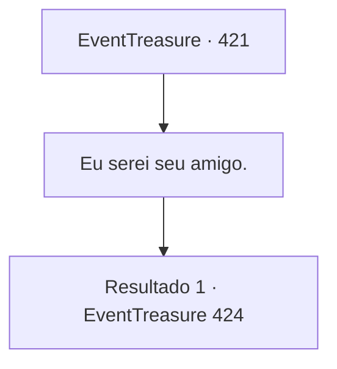

# Eventos de tesouro · 421

[Índice da tabela](index.md) · [Índice geral](../index.md)

ID: `pt:EventTreasure:421` · Fonte: `EventTreasure4` · Versão: 1.2.47.

Mapeamento estático dos arquivos; a disponibilidade e a execução dependem do estado da run.

## Texto do evento

*Sem texto no arquivo.*

## Dados de entrada

```json
{
  "id": 421,
  "grade": 1,
  "place": "",
  "required": ""
}
```

## Mapa das escolhas



## Escolhas e resultados

### Escolha 1

Eu serei seu amigo.

Requisitos e outros campos da escolha:

```json
{
  "required": ""
}
```

#### Resultado 1.1

Com a sua oferta, a aura feroz do espírito suavizou. Ele circulou ao seu redor por um momento antes de irromper repentinamente em gargalhadas. 

 "Kuhahaha! Que divertido. Posso sentir uma presença dentro de você, algo como a do meu antigo amigo… Uma atração, como se eu estivesse sendo puxado para você… Gosto disso."

  O espírito estendeu a mão na sua direção. 

 "Então… compartilharei meu poder com você, como um sinal de nossa amizade."

  Eletricidade pura dançava na palma de sua mão. Sem hesitar, você segurou a mão dele, e uma corrente intensa irrompeu pelo seu corpo.  

 "Até nos encontrarmos novamente, meu amigo."

  Com essas palavras, o espírito desapareceu, e a tempestade nos céus começou a se dissipar lentamente.

Continuação registrada: [Evento 424](0424.md) na mesma tabela.

```json
{
  "required": "",
  "chance": "1",
  "nextEvent": 424,
  "type": 2,
  "reward": "27_56_1"
}
```

## Referências que chegam a este evento

- [Evento 420 · escolha 1 · resultado 1](0420.md#escolha-1)
