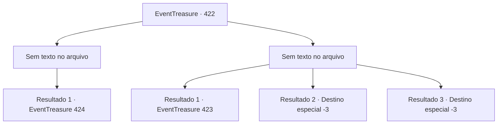

# Eventos de tesouro · 422

[Índice da tabela](index.md) · [Índice geral](../index.md)

ID: `pt:EventTreasure:422` · Fonte: `EventTreasure4` · Versão: 1.2.47.

Mapeamento estático dos arquivos; a disponibilidade e a execução dependem do estado da run.

## Texto do evento

*Sem texto no arquivo.*

## Dados de entrada

```json
{
  "id": 422,
  "grade": 1,
  "place": "",
  "required": ""
}
```

## Mapa das escolhas



## Escolhas e resultados

### Escolha 1

*Sem texto no arquivo; o papel dessa opção depende da interface do jogo.*

Requisitos e outros campos da escolha:

```json
{
  "required": ""
}
```

#### Resultado 1.1

Você lutou contra o espírito, e, com o passar do tempo, você percebeu que seu poder ia aos poucos enfraquecendo. Sua forma ficava cada vez mais tênue, mas, ainda assim, ele não cedeu— desferindo um último golpe furioso contra você. <link=shake>‘BZZZZT-!!’</link>  A corrente abrasadora rasgou o ar e atingiu você de frente. Em meio a uma dor excruciante, seu corpo começou a absorver a energia de relâmpago do espírito, como uma esponja absorvendo água.  

 "Isso…! Meu poder…?!"

 O espírito vacilou, chocado, e interrompeu o ataque, mas já era tarde demais. O relâmpago dentro de você despertou com força explosiva. O espírito, exaurido de forças, ficou transparente e aos poucos desapareceu. 

 "Pensar que… eu não consegui sequer vingar meu amigo…"

  E, com isso, o espírito se foi— e os céus se clarearam.

Continuação registrada: [Evento 424](0424.md) na mesma tabela.

```json
{
  "required": "",
  "chance": "1",
  "nextEvent": 424,
  "type": 2,
  "reward": "27_56_1"
}
```

### Escolha 2

*Sem texto no arquivo; o papel dessa opção depende da interface do jogo.*

Requisitos e outros campos da escolha:

```json
{
  "required": ""
}
```

#### Resultado 2.1

Você enfrentou a fúria do espírito, mas foi demais. <link=shake>‘BZZZZT-!!’</link> A violenta corrente rasgou o ar e se chocou contra você, arremessando você além da borda do penhasco, onde você perdeu a consciência.

Continuação registrada: [Evento 423](0423.md) na mesma tabela.

```json
{
  "required": "1_0_2|1_1_2",
  "chance": "1",
  "nextEvent": 423,
  "type": 2,
  "reward": "5_862_9|0_0_-1|0_1_-1"
}
```

#### Resultado 2.2

O relâmpago do espírito atingiu você em cheio, e, num instante, seu corpo foi reduzido a uma carcaça carbonizada.

Continuação registrada: [Destino especial `-3`](../destinos-especiais.md).

```json
{
  "required": "2_0_2",
  "chance": "1",
  "nextEvent": -3,
  "type": 2,
  "reward": "0_0_-1|0_1_-1"
}
```

#### Resultado 2.3

O relâmpago do espírito atingiu você em cheio, e, num instante, seu corpo foi reduzido a uma carcaça carbonizada.

Continuação registrada: [Destino especial `-3`](../destinos-especiais.md).

```json
{
  "required": "2_1_2",
  "chance": "1",
  "nextEvent": -3,
  "type": 2,
  "reward": "0_0_-1|0_1_-1"
}
```

## Referências que chegam a este evento

- [Evento 420 · escolha 1 · resultado 2](0420.md#escolha-1)
- [Evento 420 · escolha 2 · resultado 1](0420.md#escolha-2)
