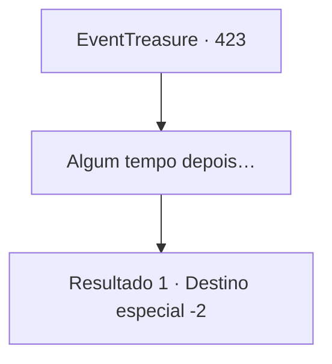

# Eventos de tesouro · 423

[Índice da tabela](index.md) · [Índice geral](../index.md)

ID: `pt:EventTreasure:423` · Fonte: `EventTreasure4` · Versão: 1.2.47.

Mapeamento estático dos arquivos; a disponibilidade e a execução dependem do estado da run.

## Texto do evento

*Sem texto no arquivo.*

## Dados de entrada

```json
{
  "id": 423,
  "grade": 1,
  "place": "",
  "required": ""
}
```

## Mapa das escolhas



## Escolhas e resultados

### Escolha 1

Algum tempo depois…

Requisitos e outros campos da escolha:

```json
{
  "required": ""
}
```

#### Resultado 1.1

Quem sabe quanto tempo havia passado. Quando você recobrou a consciência e abriu os olhos, percebeu que estava deitado na cama de uma casa humilde e desconhecida. Ao olhar ao redor e tentar se sentar, o mesmo ancião de antes ajudou você a ficar de pé.  

 "Você está bem? Houve um clarão, e então você despencou do penhasco. Sorte que ficou preso em uma árvore — caso contrário, com certeza teria morrido."

  Nesse instante, uma dor aguda percorreu seu corpo. Ao olhar para baixo, você viu as marcas chamuscadas deixadas onde o raio havia queimado sua carne.  O ancião soltou um suspiro pesado. 

 "Pelas suas condições, não posso exigir mais nada de você. De qualquer forma... obrigado pelo que fez."

  Ele disse que a esposa havia preparado um mingau de aveia e insistiu para que você tomasse ao menos uma tigela antes de partir, colocando diante de você um pedaço de pão duro e um mingau simples.  Você encheu o estômago com a refeição e se despediu do ancião. Acima, a tempestade ainda pairava sobre o penhasco, enfurecida com o luto por um amigo perdido, e você deixou a aldeia para trás às pressas.

Continuação registrada: [Destino especial `-2`](../destinos-especiais.md).

```json
{
  "required": "",
  "chance": "1",
  "nextEvent": -2,
  "type": 2,
  "reward": "0_0_1"
}
```

## Referências que chegam a este evento

- [Evento 422 · escolha 2 · resultado 1](0422.md#escolha-2)
