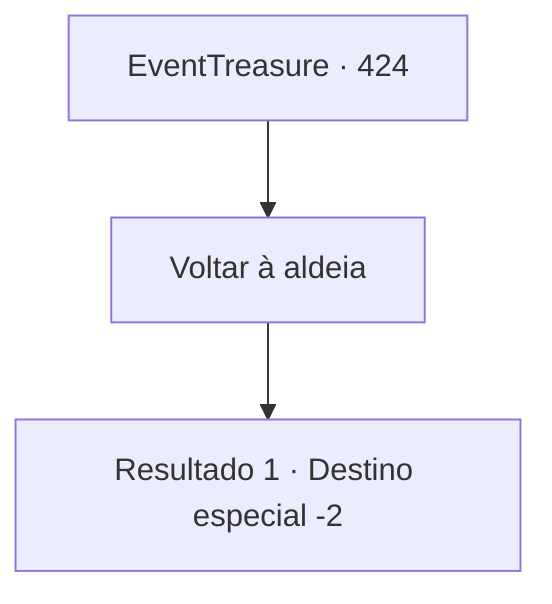

# Eventos de tesouro · 424

[Índice da tabela](index.md) · [Índice geral](../index.md)

ID: `pt:EventTreasure:424` · Fonte: `EventTreasure4` · Versão: 1.2.47.

Mapeamento estático dos arquivos; a disponibilidade e a execução dependem do estado da run.

## Texto do evento

*Sem texto no arquivo.*

## Dados de entrada

```json
{
  "id": 424,
  "grade": 1,
  "place": "",
  "required": ""
}
```

## Mapa das escolhas



## Escolhas e resultados

### Escolha 1

Voltar à aldeia

Requisitos e outros campos da escolha:

```json
{
  "required": ""
}
```

#### Resultado 1.1

Você desceu de volta pelo caminho da montanha e retornou à vila. Na pequena praça, o ancião, a mulher e os pescadores estavam reunidos, esperando por você. Ao verem que o céu havia clareado, ergueram os braços de alegria para recebê-lo.  

 "Obrigado por nos salvar! Não sabemos o que teríamos feito sem você!"

 "Aliás… você descobriu qual era o problema?"

  À pergunta do pescador, você explicou que os problemas começaram quando a rocha foi destruída. Quando o espírito perdeu a rocha que considerava amiga, sua fúria foi desencadeada sobre a vila.  Ao ouvir isso, os moradores da vila ficaram com expressões de alívio e culpa. Após um breve silêncio, o ancião falou de novo para aliviar o clima. 

 "Ah, é claro — precisamos recompensá-lo. Obrigado pelo que você fez pela nossa vila."

  Ele explicou que os moradores da vila haviam contribuído, cada um, com um pouco, e lhe entregou uma bolsa cheia de ouro.  Você aceitou a recompensa e então partiu da vila.

Continuação registrada: [Destino especial `-2`](../destinos-especiais.md).

```json
{
  "required": "",
  "chance": "1",
  "nextEvent": -2,
  "type": 2,
  "reward": "5_862_9|0_4_100"
}
```

## Referências que chegam a este evento

- [Evento 421 · escolha 1 · resultado 1](0421.md#escolha-1)
- [Evento 422 · escolha 1 · resultado 1](0422.md#escolha-1)
