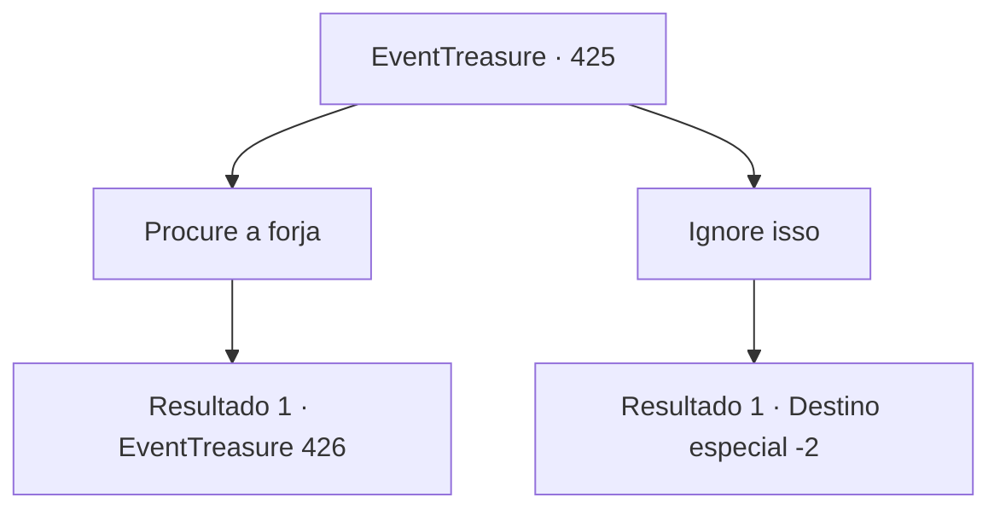

# Eventos de tesouro · 425

[Índice da tabela](index.md) · [Índice geral](../index.md)

ID: `pt:EventTreasure:425` · Fonte: `EventTreasure4` · Versão: 1.2.47.

Mapeamento estático dos arquivos; a disponibilidade e a execução dependem do estado da run.

## Texto do evento

Você seguiu o som das marteladas que ecoavam ao longe. Como que enfeitiçado, seus passos se moviam sem sua vontade, levando você adiante sem sentir nada. O caminho serpenteava por uma encosta vulcânica acidentada, conduzindo você por entre rochas negras endurecidas de lava resfriada rumo a um destino desconhecido. |drawing_forgeInDream| ‘Clang–! Clang–!’
  Apresando o passo, você finalmente chegou. No fundo do vulcão, dentro de uma caverna imersa em calor incandescente, uma forja se revelou. O brilho vermelho da fornalha dançava, e o tinido do aço golpeado pelo martelo ressoava.  

 "Eu estava esperando."

 A voz soou pesada, como ferro chocando contra ferro.  E, com essa voz, você abriu os olhos. O chilrear dos pássaros puxou sua consciência de volta à realidade. Você despertou e olhou ao redor. O lugar em que você se encontrava era o acampamento onde havia se deitado para dormir na noite anterior.

## Dados de entrada

```json
{
  "id": 425,
  "grade": 2,
  "place": "",
  "required": "1_2_50|5_875_0|26_44_1"
}
```

## Mapa das escolhas



## Escolhas e resultados

### Escolha 1

Procure a forja

Requisitos e outros campos da escolha:

```json
{
  "required": ""
}
```

#### Resultado 1.1

Você sentiu um impulso inexplicável e, sem pensar, seguiu o caminho que havia visto em seu sonho. 

 Vários dias depois, você finalmente descobriu o próprio vulcão da sua visão. Você pousou os pés na encosta vulcânica acidentada, abrindo caminho entre rochas negras formadas por lava endurecida. Depois de subir a encosta, onde seus passos afundavam profundamente na lama e na cinza, você finalmente chegou à forja.  

 "Cof, cof…! Quem vai lá? Que assunto o traz aqui?"

  Lá, você encontrou um anão manco que vivia dentro da forja. Sentado em um banquinho baixo, ele acariciava um pequeno martelo antes de notar sua presença. O movimento de suas mãos trazia a marca de um artesanato forjado ao longo de muitos anos e, quando seus olhos pousaram em você, carregavam tanto cautela quanto curiosidade.

Continuação registrada: [Evento 426](0426.md) na mesma tabela.

```json
{
  "required": "",
  "chance": "1",
  "nextEvent": 426,
  "type": 2,
  "reward": ""
}
```

### Escolha 2

Ignore isso

Requisitos e outros campos da escolha:

```json
{
  "required": ""
}
```

#### Resultado 2.1

Você afastou a visão que tivera em seu sonho e desmontou o acampamento. Depois, juntando seus pertences, retomou sua jornada original.

Continuação registrada: [Destino especial `-2`](../destinos-especiais.md).

```json
{
  "required": "",
  "chance": "1",
  "nextEvent": -2,
  "type": 2,
  "reward": "5_875_9"
}
```

## Referências que chegam a este evento

Nenhum `nextEvent` positivo da mesma tabela aponta para este nó. Isso não prova que seja inacessível: sorteio e estado de história podem selecioná-lo.

