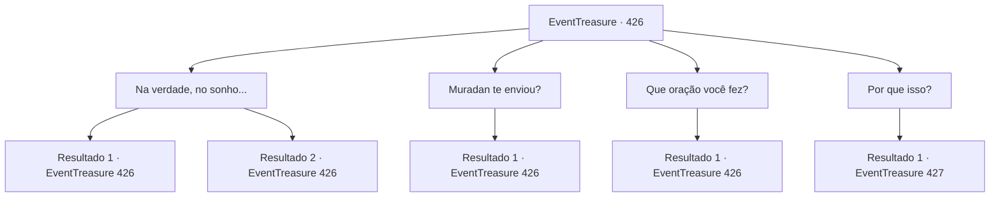

# Eventos de tesouro · 426

[Índice da tabela](index.md) · [Índice geral](../index.md)

ID: `pt:EventTreasure:426` · Fonte: `EventTreasure4` · Versão: 1.2.47.

Mapeamento estático dos arquivos; a disponibilidade e a execução dependem do estado da run.

## Texto do evento

*Sem texto no arquivo.*

## Dados de entrada

```json
{
  "id": 426,
  "grade": 1,
  "place": "",
  "required": ""
}
```

## Mapa das escolhas



## Escolhas e resultados

### Escolha 1

Na verdade, no sonho...

Requisitos e outros campos da escolha:

```json
{
  "required": "5_876_0"
}
```

#### Resultado 1.1

Você explicou cuidadosamente ao anão misterioso como tinha vindo até aqui — começando pelo próprio sonho. As marteladas que você ouvira enquanto caminhava pela encosta do vulcão, a imagem viva da forja, e como você seguiu esse caminho no mundo desperto até que esse caminho o trouxesse até aqui. O anão ouviu com os lábios cerrados numa linha firme. Dos sulcos profundos de seu rosto, parecia transparecer uma sabedoria antiga. Por fim, quando você terminou o relato, ele esboçou um sorriso curioso e assentiu. 

 "...Entendo. Agora faz sentido. Você foi enviado por Muradan."

  Você repetiu o nome “Muradan” em sua mente. Patrono dos ferreiros e o espírito mais reverenciado do povo anão. Nascido das labaredas de uma fornalha rugidora, diz-se que Muradan preside os domínios da arte e da criação. Dizem que o metal tocado por sua mão ganha vida, e que os artesãos por ele abençoados forjam obras-primas que o mundo jamais conheceu.

Continuação registrada: [Evento 426](0426.md) na mesma tabela.

```json
{
  "required": "",
  "chance": "1|0_7_1",
  "nextEvent": 426,
  "type": 0,
  "reward": "5_876_1"
}
```

#### Resultado 1.2

Você explicou cuidadosamente ao anão misterioso como havia chegado até aqui — começando pelo próprio sonho. As marteladas que você ouvira enquanto caminhava pela encosta do vulcão, a imagem viva da forja, e como você seguiu aquele caminho no mundo desperto até que ele o trouxesse até aqui. O anão ouviu com os lábios fixos numa linha firme. Pelos sulcos profundos de seu rosto, parecia que uma sabedoria antiga se infiltrava. Por fim, quando seu relato terminou, ele esboçou um sorriso curioso e assentiu. 

 "...Entendo. Agora faz sentido. Você foi enviado por Muradan."

  Você não sabia o que era Muradan. Mas, pelo modo do anão, parecia claro que Muradan era o deus a quem ele servia.

Continuação registrada: [Evento 426](0426.md) na mesma tabela.

```json
{
  "required": "",
  "chance": "14",
  "nextEvent": 426,
  "type": 1,
  "reward": "5_876_1"
}
```

### Escolha 2

Muradan te enviou?

Requisitos e outros campos da escolha:

```json
{
  "required": "5_876_1"
}
```

#### Resultado 2.1

Antes de responder à sua pergunta, ele se apresentou. O anão manco era um ferreiro de nome Baldur. 

 "Para explicar isso… teremos de voltar muito no tempo. Voltar a antes mesmo de eu atingir a maioridade — quando eu ainda era um fedelho inexperiente."

  O olhar de Baldur se perdeu ao longe, como se seus olhos corressem rio acima pelo curso do tempo; ali se cruzavam saudade e dor. 

 "Na aldeia onde eu vivia, havia uma mulher chamada Hilde — uma beleza. Era filha do chefe, do tipo que conquistava qualquer coração com um único sorriso. Todo homem da aldeia a desejava. Eu não era exceção."

  Ele pigarreou de leve e continuou. 

 "Quando ela atingiu a maioridade, o chefe fez uma proclamação: 'Dentro de três meses, quem forjar a melhor espada e apresentá-la a mim ficará com Hilde.' Mas, com a habilidade que eu tinha na época, uma espada dessas era impossível. No fim… não me restou opção senão rezar para Muradan."


Continuação registrada: [Evento 426](0426.md) na mesma tabela.

```json
{
  "required": "",
  "chance": "1",
  "nextEvent": 426,
  "type": 2,
  "reward": "5_876_2"
}
```

### Escolha 3

Que oração você fez?

Requisitos e outros campos da escolha:

```json
{
  "required": "5_876_2"
}
```

#### Resultado 3.1

À sua pergunta, Baldur esboçou um pequeno sorriso amargo e falou. 

 "Se ele me deixasse desposar Hilde… jurei forjar uma lâmina maior do que a do chefe — a mais sublime obra-prima da minha vida — e dedicá-la a Muradan."

  Um traço do desespero de sua juventude ainda coloria sua voz. 

 "E então algo realmente prodigioso aconteceu. Muradan atendeu à minha prece."

  Baldur fez uma pausa e olhou para as próprias mãos. Ásperas e marcadas por cicatrizes, tremiam muito de leve, como se segurassem algo invisível. Embora muitos anos tivessem se passado, o milagre ainda estava vívido em sua memória. 

 "Em uma única noite, terminei uma espada que estas mãos não deveriam ser capazes de fazer. Graças a isso, pude me casar com Hilde."

  Seu olhar voltou das lembranças para você, e uma sombra o atravessou — como se carregasse um fardo pesado junto da saudade dos dias mais felizes. 

 "Muitos anos se passaram desde então. As crianças cresceram e partiram… e minha amada Hilde foi para os céus antes de mim. Agora é a minha vez de cumprir a promessa. Mas…"

  As últimas palavras ficaram suspensas no ar, inacabadas. Preocupação e uma espécie de desespero anuviaram o rosto de Baldur.

Continuação registrada: [Evento 426](0426.md) na mesma tabela.

```json
{
  "required": "",
  "chance": "1",
  "nextEvent": 426,
  "type": 2,
  "reward": "5_876_3"
}
```

### Escolha 4

Por que isso?

Requisitos e outros campos da escolha:

```json
{
  "required": "5_876_3"
}
```

#### Resultado 4.1

Quando você perguntou por quê, Baldur respondeu com um longo suspiro cansado. 

 "O que farei — já decidi. Mas agora estou velho e doente. Hoje em dia mal consigo forjar uma espada comum, quanto mais a obra-prima de uma vida."

  Você o observou de perto. Vários de seus dedos calejados haviam sido decepados, e o braço que um dia dominara o aço estava fino e debilitado. Um dos olhos estava esbranquiçado; parecia duvidoso que ainda pudesse enxergar o trabalho minucioso.  

 "Fiz aquele voto de oferecer uma obra-prima… e, ainda assim, tinha medo de não conseguir realizá-la. Tanto medo que nem sequer comecei."

 A voz de Baldur tremeu. 

 "Não é diferente de enganar um deus. E então — você veio até mim. Se isto não é a vontade de Muradan, o que é?"

  A mão áspera e pesada de Baldur apertou a sua. 

 "…Por favor, ajude-me. Se o fizer, Muradan não esquecerá o favor."

  Em seus olhos ardia uma esperança desesperada — a última, depositada em você.

Continuação registrada: [Evento 427](0427.md) na mesma tabela.

```json
{
  "required": "",
  "chance": "1",
  "nextEvent": 427,
  "type": 2,
  "reward": ""
}
```

## Referências que chegam a este evento

- [Evento 425 · escolha 1 · resultado 1](0425.md#escolha-1)
- [Evento 426 · escolha 1 · resultado 1](0426.md#escolha-1)
- [Evento 426 · escolha 1 · resultado 2](0426.md#escolha-1)
- [Evento 426 · escolha 2 · resultado 1](0426.md#escolha-2)
- [Evento 426 · escolha 3 · resultado 1](0426.md#escolha-3)
