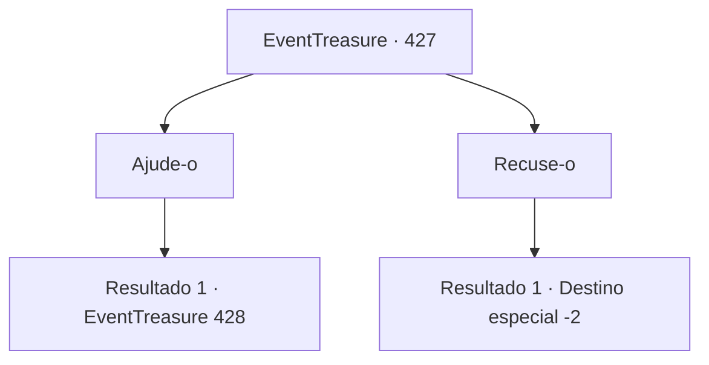

# Eventos de tesouro · 427

[Índice da tabela](index.md) · [Índice geral](../index.md)

ID: `pt:EventTreasure:427` · Fonte: `EventTreasure4` · Versão: 1.2.47.

Mapeamento estático dos arquivos; a disponibilidade e a execução dependem do estado da run.

## Texto do evento

*Sem texto no arquivo.*

## Dados de entrada

```json
{
  "id": 427,
  "grade": 1,
  "place": "",
  "required": ""
}
```

## Mapa das escolhas



## Escolhas e resultados

### Escolha 1

Ajude-o

Requisitos e outros campos da escolha:

```json
{
  "required": ""
}
```

#### Resultado 1.1

Você concordou em ajudá-lo e entrou na forja. No momento em que cruzou o limiar, uma visão misteriosa se revelou. A forja parecia uma caverna estreita escavada no próprio coração do vulcão. As paredes, enegrecidas por séculos de fumaça, erguiam-se ao seu redor, enquanto o chão estava coberto de incontáveis fragmentos de metal e montes de cinzas — vestígios de um trabalho infindável.  Seu olhar se deteve em uma seção da parede. Ali, magma incandescente escorria lentamente pelas fendas da rocha.  

 "Maravilhoso, não é? Eu construí este sistema para extrair diretamente a lava do vulcão. Agora então, vamos começar."

  O trabalho começou de imediato. A primeira tarefa foi derreter o metal lendário, adamantina, usando as chamas do próprio magma.  Seguindo as instruções de Baldur, você colocou o metal precioso na fornalha e, com a força primordial do vulcão, ele começou a derreter. O processo em si não era tão complexo, mas o calor abrasador que jorrava da lava era implacável, torturando você sem pausa.  O suor escorria de você como chuva, mas você não desistiu. Por fim, a adamantina derreteu completamente em um líquido prateado cintilante e, junto com Baldur, você o verteu cuidadosamente em um molde em forma de espada preparado de antemão.  Com o passar do tempo e o resfriamento do metal, a forma básica da lâmina começou a ganhar forma.  

 "Agora, a têmpera. Vou deixar esta parte por sua conta."

 Colocando a espada na bancada de trabalho, Baldur lhe entregou o martelo.

Continuação registrada: [Evento 428](0428.md) na mesma tabela.

```json
{
  "required": "",
  "chance": "1",
  "nextEvent": 428,
  "type": 2,
  "reward": ""
}
```

### Escolha 2

Recuse-o

Requisitos e outros campos da escolha:

```json
{
  "required": ""
}
```

#### Resultado 2.1

Você recusou o pedido dele e deixou a forja para trás. Baldur tentou alcançá-lo para impedi-lo, mas, com a perna ferida, era impossível acompanhá-lo. Você deixou o lugar por completo e continuou sua jornada original.

Continuação registrada: [Destino especial `-2`](../destinos-especiais.md).

```json
{
  "required": "",
  "chance": "1",
  "nextEvent": -2,
  "type": 2,
  "reward": "5_875_9"
}
```

## Referências que chegam a este evento

- [Evento 426 · escolha 4 · resultado 1](0426.md#escolha-4)
