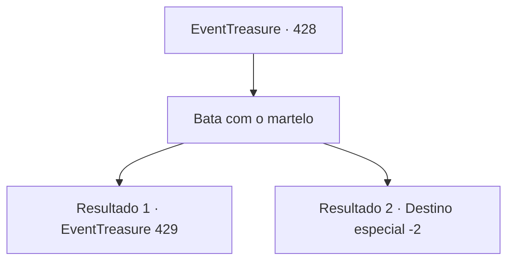

# Eventos de tesouro · 428

[Índice da tabela](index.md) · [Índice geral](../index.md)

ID: `pt:EventTreasure:428` · Fonte: `EventTreasure4` · Versão: 1.2.47.

Mapeamento estático dos arquivos; a disponibilidade e a execução dependem do estado da run.

## Texto do evento

*Sem texto no arquivo.*

## Dados de entrada

```json
{
  "id": 428,
  "grade": 1,
  "place": "",
  "required": ""
}
```

## Mapa das escolhas



## Escolhas e resultados

### Escolha 1

Bata com o martelo

Requisitos e outros campos da escolha:

```json
{
  "required": ""
}
```

#### Resultado 1.1

Baldur segurava o metal incandescente com tenazes, enquanto você se lançava à martelagem. Cada pancada do martelo contra o aço em brasa enviava uma vibração profunda pelo seu pulso, e as faíscas que voavam iluminavam a forja em clarões brilhantes. Aquilo não era mero trabalho — era um rito sagrado transmitido desde eras remotas. Cada golpe do martelo insuflava vida na adamantina, gravando profundamente no metal a bênção de Muradan.  O trabalho prosseguiu por longas horas. Passou-se um dia, depois outro. Seus braços e ombros ficavam mais pesados a cada golpe, mas lentamente a lâmina começou a tomar forma.  

 "Assim basta. Eu mesmo vou afiar o fio. Vou deixar os retoques finais para você."

 Por fim, Baldur assentiu com um olhar de satisfação. Ele aqueceu a espada mais uma vez na lava, temperou-a em óleo e imediatamente começou o polimento. Você o observava atentamente, preparando-se para a tarefa final. Grossas gotas de suor escorriam pela linha do seu maxilar.

Continuação registrada: [Evento 429](0429.md) na mesma tabela.

```json
{
  "required": "",
  "chance": "1|0_5_1|0_13_1",
  "nextEvent": 429,
  "type": 0,
  "reward": ""
}
```

#### Resultado 1.2

Baldur segurava o metal incandescente com as tenazes, enquanto você se lançava à martelagem. Cada golpe do martelo contra o aço em brasa enviava uma vibração áspera pelo seu pulso, e minúsculas fagulhas saltavam para suas mãos e antebraços, chamuscando sua pele.  O calor infernal da fornalha corroía sua resistência sem piedade. À medida que o tempo se arrastava, o martelo ficava cada vez mais pesado, até que seus braços já não lhe obedeciam. Por fim, você sucumbiu ao cansaço esmagador.  O baque surdo do martelo caindo ao chão encheu a forja. Ambas as mãos tremiam violentamente.  

 "…Pelo visto, Muradan não enviou você, afinal. Ainda assim, agradeço pelo pouco que fez."

 A voz de Baldur carregava uma profunda decepção, e sua expressão escureceu quando sua última esperança se desfez.  Com as mãos trêmulas, você lhe devolveu o martelo e deixou a forja com passos pesados.

Continuação registrada: [Destino especial `-2`](../destinos-especiais.md).

```json
{
  "required": "",
  "chance": "18",
  "nextEvent": -2,
  "type": 1,
  "reward": "5_875_9"
}
```

## Referências que chegam a este evento

- [Evento 427 · escolha 1 · resultado 1](0427.md#escolha-1)
