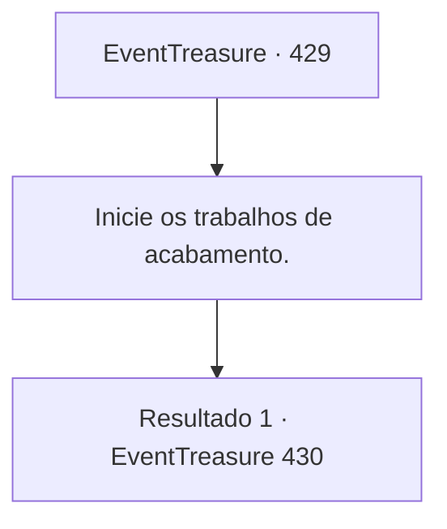

# Eventos de tesouro · 429

[Índice da tabela](index.md) · [Índice geral](../index.md)

ID: `pt:EventTreasure:429` · Fonte: `EventTreasure4` · Versão: 1.2.47.

Mapeamento estático dos arquivos; a disponibilidade e a execução dependem do estado da run.

## Texto do evento

*Sem texto no arquivo.*

## Dados de entrada

```json
{
  "id": 429,
  "grade": 1,
  "place": "",
  "required": ""
}
```

## Mapa das escolhas



## Escolhas e resultados

### Escolha 1

Inicie os trabalhos de acabamento.

Requisitos e outros campos da escolha:

```json
{
  "required": ""
}
```

#### Resultado 1.1

O trabalho de acabamento era o delicado processo de trazer a espada à sua forma plena. Ajustaste a guarda e o punho robustos à lâmina concluída, acrescentaste adornos intrincados e até gravaste o santo nome de Muradan em sua superfície. Foi uma tarefa que exigiu tanto força quanto precisão — uma arte da mais alta ordem.  Incrivelmente, tu e Baldur concluístes cada etapa juntos, finalizando com sucesso a obra-prima. Era como se a mão invisível do próprio Muradan vos tivesse guiado, pois cada parte do processo fluía com uma graça misteriosa.  Nesse momento, a luz morna do sol entrou pela janela, iluminando suavemente a espada concluída. A lâmina cintilava com um brilho místico e escuro que banhava toda a forja.  Um leve arquejo escapou dos lábios de Baldur. 

 "…Juramento. Esse será o nome desta lâmina."

  Fitando a espada com reverência, Baldur ergueu-a lentamente, como se realizasse um rito sagrado. Então, entregando-te Juramento, falou em voz baixa. 

 "Um último pedido. Leva-a ao cume deste vulcão e oferece-a a Muradan, lançando-a na cratera."

  Em sua voz havia o alívio de finalmente poder cumprir seu voto, e a profundidade da gratidão que o acompanhava.

Continuação registrada: [Evento 430](0430.md) na mesma tabela.

```json
{
  "required": "",
  "chance": "1",
  "nextEvent": 430,
  "type": 2,
  "reward": ""
}
```

## Referências que chegam a este evento

- [Evento 428 · escolha 1 · resultado 1](0428.md#escolha-1)
