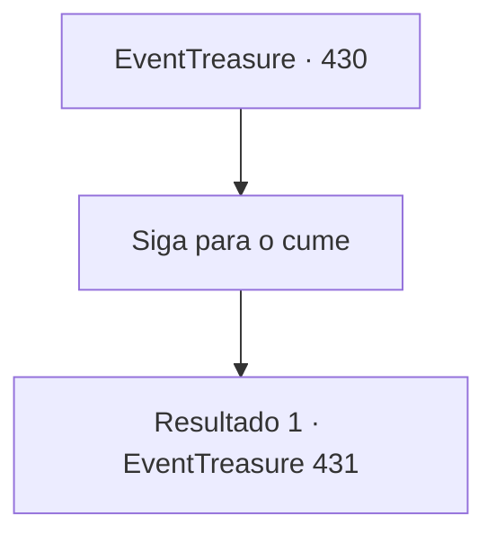

# Eventos de tesouro · 430

[Índice da tabela](index.md) · [Índice geral](../index.md)

ID: `pt:EventTreasure:430` · Fonte: `EventTreasure4` · Versão: 1.2.47.

Mapeamento estático dos arquivos; a disponibilidade e a execução dependem do estado da run.

## Texto do evento

*Sem texto no arquivo.*

## Dados de entrada

```json
{
  "id": 430,
  "grade": 1,
  "place": "",
  "required": ""
}
```

## Mapa das escolhas



## Escolhas e resultados

### Escolha 1

Siga para o cume

Requisitos e outros campos da escolha:

```json
{
  "required": ""
}
```

#### Resultado 1.1

Com Oath em suas mãos, você deixou a forja e iniciou a subida até o cume da montanha. Atrás de você, podia sentir o olhar silencioso de Baldur em suas costas.  O vulcão não era especialmente alto, mas quanto mais você se aproximava do pico, mais forte ficava o fedor de enxofre, e o calor opressivo grudava em seus passos. Quando finalmente alcançou o cume, quase três horas haviam se passado desde que você começou.  Com cuidado, você avançou até a borda da cratera. No interior, lava derretida borbulhava e se revolvia, e seus lentos movimentos liberavam ondas de calor escaldante.  Lentamente, você sacou a espada de Baldur, Oath. O brilho escuro da lâmina cintilou de leve, emanando uma radiância hipnotizante.

Continuação registrada: [Evento 431](0431.md) na mesma tabela.

```json
{
  "required": "",
  "chance": "1",
  "nextEvent": 431,
  "type": 2,
  "reward": "3_372_1"
}
```

## Referências que chegam a este evento

- [Evento 429 · escolha 1 · resultado 1](0429.md#escolha-1)
