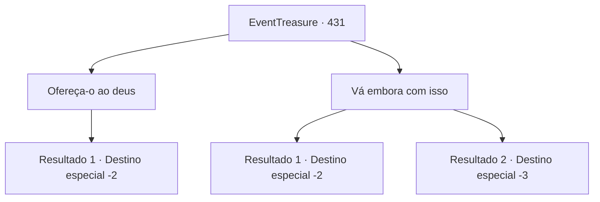

# Eventos de tesouro · 431

[Índice da tabela](index.md) · [Índice geral](../index.md)

ID: `pt:EventTreasure:431` · Fonte: `EventTreasure4` · Versão: 1.2.47.

Mapeamento estático dos arquivos; a disponibilidade e a execução dependem do estado da run.

## Texto do evento

*Sem texto no arquivo.*

## Dados de entrada

```json
{
  "id": 431,
  "grade": 1,
  "place": "",
  "required": ""
}
```

## Mapa das escolhas



## Escolhas e resultados

### Escolha 1

Ofereça-o ao deus

Requisitos e outros campos da escolha:

```json
{
  "required": ""
}
```

#### Resultado 1.1

Você levou Oath ao cume do vulcão. Abrindo caminho por entre rochas irregulares e um calor opressivo, você finalmente alcançou a cratera, onde a visão da lava borbulhante se estendia diante de você.  Depois de oferecer uma prece sincera a Muradan, você lançou Oath com cuidado nas profundezas da cratera. A obra-prima adamantina afundou lentamente no magma revolto até desaparecer de vista.  Nesse momento, um enorme pilar de chamas irrompeu da cratera em direção ao céu. O calor escaldante roçou sua pele e, para seu espanto, as chamas não o queimaram nem um pouco. Em algum momento, a bênção sagrada de Muradan havia se instalado em você.  Você gravou esse momento de graça divina no fundo do coração e tomou o caminho de volta à forja.  Quando o sol já se punha atrás das colinas do oeste, você voltou e encontrou Baldur ainda sentado em seu banquinho baixo. Você se aproximou em silêncio, apenas para ver que ele agora apertava o amado martelo nos braços, tendo caído em sono eterno. Seu rosto estava sereno, como se enfim tivesse deposto o pesado fardo que o assombrara por tantos anos.  Você ofereceu uma prece silenciosa por seu descanso e então seguiu seu caminho.

Continuação registrada: [Destino especial `-2`](../destinos-especiais.md).

```json
{
  "required": "",
  "chance": "1",
  "nextEvent": -2,
  "type": 2,
  "reward": "4_372_1|27_53_1|5_875_9"
}
```

### Escolha 2

Vá embora com isso

Requisitos e outros campos da escolha:

```json
{
  "required": ""
}
```

#### Resultado 2.1

Você fitou Oath e então o guardou silenciosamente. Virando as costas, você fugiu da cratera — decidido a ficar para si com a obra-prima destinada ao deus.  KRAAAASH! RRRUMMMBLE!!  Seria a ira do deus dos ferreiros? Gêiseres irromperam, e o chão desmoronou sob seus pés, bloqueando seu caminho. Você despencou pela encosta da montanha, mas não parou.  Felizmente, a fúria de Muradan não o seguiu depois que você escapou do domínio do vulcão.

Continuação registrada: [Destino especial `-2`](../destinos-especiais.md).

```json
{
  "required": "1_0_2",
  "chance": "1",
  "nextEvent": -2,
  "type": 2,
  "reward": "0_3_-3|0_0_-1|5_875_9"
}
```

#### Resultado 2.2

Você contemplou Oath antes de, silenciosamente, o acolher nos braços. Então, virando as costas, você fugiu — com a intenção de reivindicar para si a obra-prima destinada ao deus. 

 ‘KRAAASH! RRRUMMMBLE!!’ 

 Seria a ira do deus da forja? Gêiseres irromperam, e o chão cedeu sob seus pés. Incapaz de escapar à fúria escaldante, você despencou do penhasco.

Continuação registrada: [Destino especial `-3`](../destinos-especiais.md).

```json
{
  "required": "2_0_2",
  "chance": "1",
  "nextEvent": -3,
  "type": 2,
  "reward": "0_3_-3|0_0_-1"
}
```

## Referências que chegam a este evento

- [Evento 430 · escolha 1 · resultado 1](0430.md#escolha-1)
