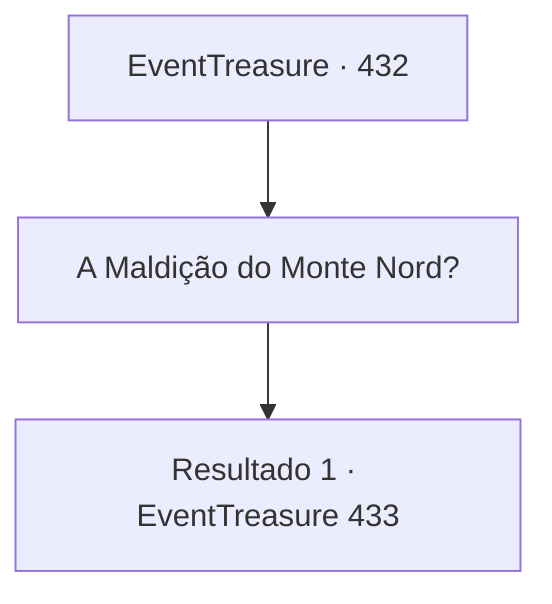

# Eventos de tesouro · 432

[Índice da tabela](index.md) · [Índice geral](../index.md)

ID: `pt:EventTreasure:432` · Fonte: `EventTreasure4` · Versão: 1.2.47.

Mapeamento estático dos arquivos; a disponibilidade e a execução dependem do estado da run.

## Texto do evento

Um vento frio roçou seu rosto. Você estava sozinho ao pé de uma imponente montanha coberta de neve, onde uma nevasca furiosa uivava sem piedade. À sua frente estendia-se uma interminável linha de picos brancos e uma cadeia acidentada oculta pelas nuvens.  Para chegar ao seu próximo destino, você teria de atravessar esta montanha perigosa. Você estava prestes a reunir coragem e dar o primeiro passo à frente quando—  

 "Espere! Você não está pensando em atravessar a Montanha Nord agora, está?"

  Um grito súbito ecoou quando um homem se apressou vindo das proximidades. Ele vestia um grosso casaco de pele, com um arco de caçador e uma aljava pendurados nas costas. Pela barba áspera e os olhos penetrantes, parecia um caçador experiente que há muito sobrevivia nestas terras altas implacáveis.  

 "Eu desaconselho fortemente. Você vai acabar vítima da “Maldição da Montanha Nord”, como tantos antes de você."


## Dados de entrada

```json
{
  "id": 432,
  "grade": 2,
  "place": "",
  "required": "1_2_50|5_877_0|26_45_1"
}
```

## Mapa das escolhas



## Escolhas e resultados

### Escolha 1

A Maldição do Monte Nord?

Requisitos e outros campos da escolha:

```json
{
  "required": ""
}
```

#### Resultado 1.1

Quando você perguntou sobre a “Maldição da Montanha Nord”, o caçador ficou em silêncio, olhando para o pico. Sua expressão era como se estivesse desenterrando memórias terríveis.  Por fim, com um suspiro pesado, falou em voz baixa. 

 "Nesta época do ano, as nevascas na Montanha Nord são implacáveis. Só isso já é perigoso — mas o verdadeiro problema está em outro lugar. Os que tentaram atravessar nesta estação… foram todos encontrados como cadáveres. Dilacerados."

  Você ouviu atentamente enquanto ele explicava. Pelo estado dos corpos, não parecia obra de uma fera comum. Alguns foram encontrados com apenas as cabeças restantes, outros partidos ao meio, e alguns reduzidos a pedaços, espalhados e descartados.  

 "Se quiser, posso levar você de volta à vila."

 Com um olhar preocupado, o caçador tentou dissuadir você mais uma vez.

Continuação registrada: [Evento 433](0433.md) na mesma tabela.

```json
{
  "required": "",
  "chance": "1",
  "nextEvent": 433,
  "type": 2,
  "reward": ""
}
```

## Referências que chegam a este evento

Nenhum `nextEvent` positivo da mesma tabela aponta para este nó. Isso não prova que seja inacessível: sorteio e estado de história podem selecioná-lo.

