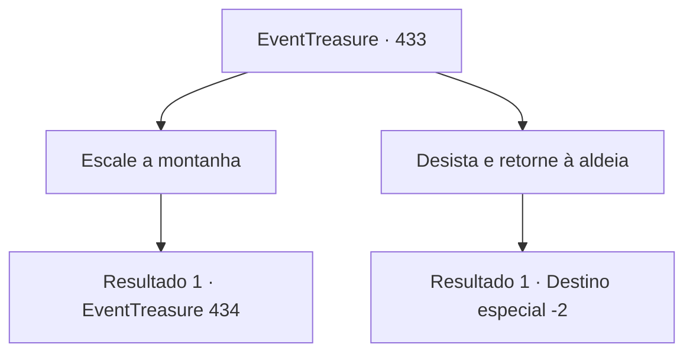

# Eventos de tesouro · 433

[Índice da tabela](index.md) · [Índice geral](../index.md)

ID: `pt:EventTreasure:433` · Fonte: `EventTreasure4` · Versão: 1.2.47.

Mapeamento estático dos arquivos; a disponibilidade e a execução dependem do estado da run.

## Texto do evento

*Sem texto no arquivo.*

## Dados de entrada

```json
{
  "id": 433,
  "grade": 1,
  "place": "",
  "required": ""
}
```

## Mapa das escolhas



## Escolhas e resultados

### Escolha 1

Escale a montanha

Requisitos e outros campos da escolha:

```json
{
  "required": ""
}
```

#### Resultado 1.1

Mas você ignorou o aviso desesperado do caçador e seguiu em direção à montanha. Felizmente, em comparação com os picos recortados ao redor, as encostas da Montanha Nord eram um tanto mais suaves. Ainda assim, a neve acumulada até os tornozelos escondia rochas ocultas e buracos profundos, quase fazendo você tropeçar mais de uma vez.  Ofegante, você subiu por um tempo — até que um obstáculo inesperado forçou você a parar. À sua frente se abria uma fenda enorme, como as mandíbulas escancaradas de alguma besta colossal. A fenda escura se estendia ampla e ameaçadora, como se fosse engolir você por completo.  Aproximando-se com cautela da beira, você espiou para baixo. Tudo que você conseguia ver era escuridão sem fim, uma profundidade que parecia não ter fundo. Um vento gelado subia do abismo, roçando seu rosto, e aos seus ouvidos sussurrava um som arrepiante, como se viesse carregado do abismo lá embaixo.

Continuação registrada: [Evento 434](0434.md) na mesma tabela.

```json
{
  "required": "",
  "chance": "1",
  "nextEvent": 434,
  "type": 2,
  "reward": ""
}
```

### Escolha 2

Desista e retorne à aldeia

Requisitos e outros campos da escolha:

```json
{
  "required": ""
}
```

#### Resultado 2.1

Você decidiu seguir o caçador de volta até a vila ao pé da montanha. Lá, você permaneceu por vários dias, esperando até que as nevascas amenizassem. Só então você partiu novamente em sua jornada.

Continuação registrada: [Destino especial `-2`](../destinos-especiais.md).

```json
{
  "required": "",
  "chance": "1",
  "nextEvent": -2,
  "type": 2,
  "reward": "5_877_9"
}
```

## Referências que chegam a este evento

- [Evento 432 · escolha 1 · resultado 1](0432.md#escolha-1)
