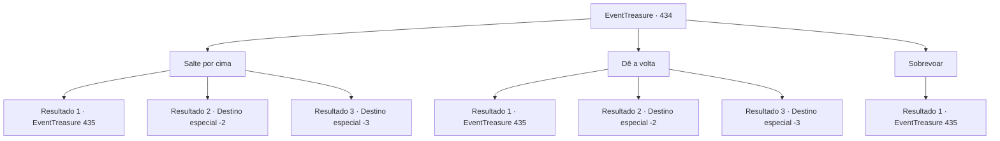

# Eventos de tesouro · 434

[Índice da tabela](index.md) · [Índice geral](../index.md)

ID: `pt:EventTreasure:434` · Fonte: `EventTreasure4` · Versão: 1.2.47.

Mapeamento estático dos arquivos; a disponibilidade e a execução dependem do estado da run.

## Texto do evento

*Sem texto no arquivo.*

## Dados de entrada

```json
{
  "id": 434,
  "grade": 1,
  "place": "",
  "required": ""
}
```

## Mapa das escolhas



## Escolhas e resultados

### Escolha 1

Salte por cima

Requisitos e outros campos da escolha:

```json
{
  "required": ""
}
```

#### Resultado 1.1

Você recuou alguns passos, avaliando a largura da fenda. Parecia perigoso, mas não impossível. Respirando fundo, você correu e saltou com toda a sua força. Por um breve instante, não havia nada sob seus pés— mas, felizmente, você pousou em segurança na borda oposta.  Seu coração batia acelerado, mas você prosseguiu, continuando a escalada rumo ao cume.  Cerca de uma hora depois, após avançar com dificuldade para além da fenda, sua resistência permanecia estável, mas a nevasca na Montanha Nord ficava cada vez mais intensa. O vento golpeava você como lâminas, e nuvens cada vez mais densas de neve começaram a obscurecer sua visão. Tremendo de frio, você avançou com cuidado, passo a passo. A neve chegava até os joelhos, dificultando cada movimento.  Então, através da tormenta rodopiante, uma forma escura surgiu lentamente. Você não conseguia dizer exatamente o que era, mas seus instintos gritavam que era algo antinatural. Ao mesmo tempo, uma voz gelada ecoou ao seu ouvido.

Continuação registrada: [Evento 435](0435.md) na mesma tabela.

```json
{
  "required": "",
  "chance": "1|0_5_1",
  "nextEvent": 435,
  "type": 0,
  "reward": ""
}
```

#### Resultado 1.2

Você recuou alguns passos, respirou fundo e se lançou através da fenda. Mas a realidade foi cruel — a distância estava muito além do que seu corpo podia alcançar. Debatendo-se no ar, você despencou na escuridão abaixo, perdendo a consciência.  Quem sabe quanto tempo se passou. Um torrão de neve caindo de cima atingiu seu rosto, trazendo você lentamente de volta à consciência. Seu corpo inteiro doía, mas por sorte você havia caído em neve profunda e sobreviveu.  Gemendo, você se levantou e olhou ao redor. O fundo da fenda era bem mais largo do que você imaginara, estendendo-se como uma vasta caverna subterrânea. No seu leito corria um pequeno riacho. Seguindo seu fluxo, você caminhou pelo que pareceram horas até finalmente emergir em um vale coberto de geada, revestido de musgo e gelo. Lá, você seguiu o curso d’água morro abaixo.

Continuação registrada: [Destino especial `-2`](../destinos-especiais.md).

```json
{
  "required": "1_0_2",
  "chance": "15",
  "nextEvent": -2,
  "type": 1,
  "reward": "0_0_-1|5_877_9"
}
```

#### Resultado 1.3

Você recuou alguns passos e se lançou contra a fenda— mas o vão era grande demais. Você despencou na fenda e encontrou seu fim na escuridão gelada.

Continuação registrada: [Destino especial `-3`](../destinos-especiais.md).

```json
{
  "required": "2_0_2",
  "chance": "15",
  "nextEvent": -3,
  "type": 1,
  "reward": "0_0_-1"
}
```

### Escolha 2

Dê a volta

Requisitos e outros campos da escolha:

```json
{
  "required": ""
}
```

#### Resultado 2.1

Em vez de tentar algo imprudente, você escolheu o caminho mais seguro. Seguindo cuidadosamente a borda da fenda, você procurou um ponto de travessia. Por fim, encontrou um trecho mais estreito e atravessou com segurança para o outro lado. Então prosseguiu, voltando a subir em direção ao cume.   Cerca de uma hora após passar pela fenda, sua resistência ainda se mantinha, mas a nevasca na Montanha Nord ficava cada vez mais feroz. O vento arranhava seu corpo como facas, e densas nuvens de neve se fechavam, cegando sua visão. Tremendo de frio, você avançou passo a passo. A neve ficou tão alta que você afundava até os joelhos.  Então, através da tempestade furiosa, uma figura sombria surgiu lentamente. Você não conseguia dizer exatamente o que era, mas sentiu instintivamente que não era um ser natural. Ao mesmo tempo, uma voz gelada soou em seus ouvidos.

Continuação registrada: [Evento 435](0435.md) na mesma tabela.

```json
{
  "required": "",
  "chance": "1|0_13_1",
  "nextEvent": 435,
  "type": 0,
  "reward": ""
}
```

#### Resultado 2.2

Em vez de tentar algo imprudente, você escolheu o caminho mais seguro. Traçando cuidadosamente a borda da fenda, você procurou uma travessia. Por fim, você encontrou um trecho mais estreito e cruzou com segurança para o outro lado. Então seguiu em frente, subindo rumo ao cume mais uma vez. 

 Cerca de uma hora após passar pela fenda, sua resistência estava quase esgotada, e a nevasca só piorava. O vento cortava como lâminas, e densas nuvens de neve ofuscavam sua visão. Seu corpo tremia de frio; cada passo era cauteloso e penoso. A neve ficou tão alta que você afundava até os joelhos.  Por fim, você desabou e perdeu a consciência. 

 Quem sabe quanto tempo havia se passado. Você despertou sentindo calor. Uma cabana rústica de toras o cercava, com peles de animais nas paredes e uma lareira crepitante. Ao seu lado, estava sentado o caçador, que encontrou seu olhar. 

 "Ainda bem que fui atrás de você, ou teria morrido de frio. A nevasca está diminuindo — aqueça-se um pouco antes de partir."

  Você esperou até a tempestade passar, então se despediu do caçador e partiu novamente.

Continuação registrada: [Destino especial `-2`](../destinos-especiais.md).

```json
{
  "required": "1_0_2",
  "chance": "1",
  "nextEvent": -2,
  "type": 1,
  "reward": "0_0_-1|5_877_9"
}
```

#### Resultado 2.3

Em vez de tentar algo imprudente, você escolheu o caminho mais seguro. Seguindo cuidadosamente pela borda da fenda, você procurou uma passagem. Por fim, encontrou um trecho mais estreito e cruzou em segurança para o outro lado. Então você seguiu em frente, subindo novamente em direção ao cume.  Cerca de uma hora após passar pela fenda, sua resistência estava quase esgotada, e a nevasca só piorava. O vento rasgava você como lâminas, e pesadas nuvens de neve sufocavam sua visão. Seu corpo tremia de frio, cada passo cauteloso e penoso. A neve ficou tão profunda que você afundava até os joelhos.  Por fim, você desabou e perdeu a consciência.

Continuação registrada: [Destino especial `-3`](../destinos-especiais.md).

```json
{
  "required": "2_0_2",
  "chance": "1",
  "nextEvent": -3,
  "type": 1,
  "reward": "0_0_-1"
}
```

### Escolha 3

Sobrevoar

Requisitos e outros campos da escolha:

```json
{
  "required": "20_0_2|20_10_1"
}
```

#### Resultado 3.1

Com um breve esforço, você alçou voo e transpôs a fenda. Ao pousar em segurança do outro lado, você seguiu em frente.  Cerca de uma hora após passar pela fenda, sua resistência ainda se mantinha, mas a nevasca no Monte Nord ficava cada vez mais impiedosa. O vento arranhava seu corpo como facas, e nuvens de neve cada vez mais densas obscureciam sua visão. Você tremia de frio enquanto avançava, passo a passo, com cautela. A neve se acumulou até prender-se aos seus joelhos.  Então, através da nevasca ofuscante, uma figura escura surgiu lentamente. Você não conseguia dizer exatamente o que era, mas todo instinto alertava que era algo antinatural. Ao mesmo tempo, uma voz gelada ecoou bem perto do seu ouvido.

Continuação registrada: [Evento 435](0435.md) na mesma tabela.

```json
{
  "required": "",
  "chance": "1",
  "nextEvent": 435,
  "type": 2,
  "reward": ""
}
```

## Referências que chegam a este evento

- [Evento 433 · escolha 1 · resultado 1](0433.md#escolha-1)
