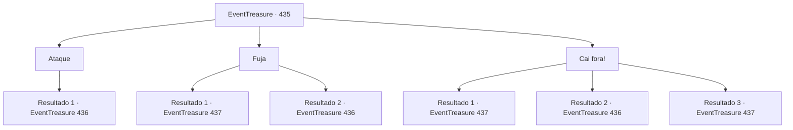

# Eventos de tesouro · 435

[Índice da tabela](index.md) · [Índice geral](../index.md)

ID: `pt:EventTreasure:435` · Fonte: `EventTreasure4` · Versão: 1.2.47.

Mapeamento estático dos arquivos; a disponibilidade e a execução dependem do estado da run.

## Texto do evento

*Sem texto no arquivo.*

## Dados de entrada

```json
{
  "id": 435,
  "grade": 1,
  "place": "",
  "required": ""
}
```

## Mapa das escolhas



## Escolhas e resultados

### Escolha 1

Ataque

Requisitos e outros campos da escolha:

```json
{
  "required": ""
}
```

#### Resultado 1.1

Através da nevasca, você atacou primeiro a figura imponente que se aproximava ameaçadoramente. Sua visão estava turva, e você não conseguia distinguir claramente o que era — mas cada instinto gritava perigo.  Seu golpe acertou, e a criatura soltou um uivo cheio de dor e fúria, sacudindo a cabeça para trás. Com a loucura ardendo nos olhos, investiu contra você com velocidade aterradora.  Você rolou para o lado a tempo de evitar o avanço mortal, então voltou a se pôr em posição de combate. Por fim, sua verdadeira forma foi revelada — diante de você erguia-se um lobo do inverno enfurecido.  Era muito maior que qualquer lobo comum; sua pelagem branca se misturava à nevasca, irradiando a silenciosa majestade de um caçador mortal. A besta exibiu as gengivas carmesim, rosnando ferozmente para você.

Continuação registrada: [Evento 436](0436.md) na mesma tabela.

```json
{
  "required": "",
  "chance": "1",
  "nextEvent": 436,
  "type": 2,
  "reward": "6_0_88",
  "place": 9
}
```

### Escolha 2

Fuja

Requisitos e outros campos da escolha:

```json
{
  "required": ""
}
```

#### Resultado 2.1

Você imediatamente virou as costas e fugiu do local. O que quer que espreitasse além da tempestade parecia não disposto a perseguir.  Depois de algum tempo, enquanto prosseguia, você se deparou com objetos deixados na neve— uma adaga elegante e uma bolsa cheia de ouro.  Ao lado deles havia várias pegadas tênues, que seguiam adiante além da trilha da montanha.

Continuação registrada: [Evento 437](0437.md) na mesma tabela.

```json
{
  "required": "",
  "chance": "1|0_7_1",
  "nextEvent": 437,
  "type": 0,
  "reward": "3_234_1|0_4_40"
}
```

#### Resultado 2.2

Você se virou para fugir de imediato— mas a coisa para além da nevasca não deixaria você escapar.  Com um uivo selvagem, ele se atirou direto contra você. Você por pouco desviou do ataque dele e se firmou.  Um lobo do inverno enfurecido exibiu as gengivas rubras, pronto para atacar novamente.

Continuação registrada: [Evento 436](0436.md) na mesma tabela.

```json
{
  "required": "",
  "chance": "14",
  "nextEvent": 436,
  "type": 1,
  "reward": "6_0_88",
  "place": 9
}
```

### Escolha 3

Cai fora!

Requisitos e outros campos da escolha:

```json
{
  "required": ""
}
```

#### Resultado 3.1

Você soltou uma ameaça feroz para afugentá-lo. Seja por medo ou por cautela, a criatura sumiu rapidamente na tempestade.  Você fitou, por um momento, a direção para onde ela havia ido e então retomou a marcha.  Logo depois, você se deparou com itens descartados na neve— uma adaga elegante e uma bolsa cheia de ouro.  Ao lado deles havia várias pegadas tênues, seguindo adiante além da trilha da montanha.

Continuação registrada: [Evento 437](0437.md) na mesma tabela.

```json
{
  "required": "21_1_2",
  "chance": "1|0_12_1",
  "nextEvent": 437,
  "type": 0,
  "reward": "3_234_1|0_4_40"
}
```

#### Resultado 3.2

Você tentou afugentá-lo com ameaças severas, mas a criatura não recuou.  Em vez disso, ergueu a cabeça com um uivo selvagem e avançou contra você. Você mal evitou a investida e se preparou novamente.  O lobo do inverno enfurecido rosnou, exibindo as gengivas carmesim enquanto saltava contra você.

Continuação registrada: [Evento 436](0436.md) na mesma tabela.

```json
{
  "required": "21_1_2",
  "chance": "14",
  "nextEvent": 436,
  "type": 1,
  "reward": "6_0_88",
  "place": 9
}
```

#### Resultado 3.3

Você soltou uma ameaça feroz para afugentá-lo. Seja por medo ou por cautela, a criatura sumiu rapidamente na tempestade.  Você fitou, por um momento, a direção para onde ela havia ido e então retomou a marcha.  Logo depois, você se deparou com itens descartados na neve— uma adaga elegante e uma bolsa cheia de ouro.  Ao lado deles havia várias pegadas tênues, seguindo adiante além da trilha da montanha.

Continuação registrada: [Evento 437](0437.md) na mesma tabela.

```json
{
  "required": "20_1_2",
  "chance": "1",
  "nextEvent": 437,
  "type": 2,
  "reward": "3_234_1|0_4_40"
}
```

## Referências que chegam a este evento

- [Evento 434 · escolha 1 · resultado 1](0434.md#escolha-1)
- [Evento 434 · escolha 2 · resultado 1](0434.md#escolha-2)
- [Evento 434 · escolha 3 · resultado 1](0434.md#escolha-3)
