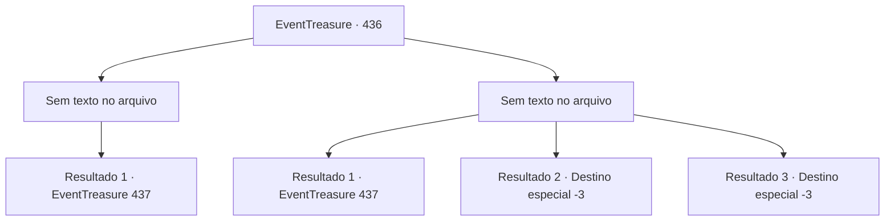

# Eventos de tesouro · 436

[Índice da tabela](index.md) · [Índice geral](../index.md)

ID: `pt:EventTreasure:436` · Fonte: `EventTreasure4` · Versão: 1.2.47.

Mapeamento estático dos arquivos; a disponibilidade e a execução dependem do estado da run.

## Texto do evento

*Sem texto no arquivo.*

## Dados de entrada

```json
{
  "id": 436,
  "grade": 1,
  "place": "",
  "required": ""
}
```

## Mapa das escolhas



## Escolhas e resultados

### Escolha 1

*Sem texto no arquivo; o papel dessa opção depende da interface do jogo.*

Requisitos e outros campos da escolha:

```json
{
  "required": ""
}
```

#### Resultado 1.1

O lobo invernal lutou ferozmente até o fim, mas por fim caiu diante de você. Você pôs fim à sua vida e deixou para trás o campo nevado manchado de sangue enquanto seguia adiante.  Depois de algum tempo, você encontrou itens abandonados na neve—uma adaga elegante e uma bolsa cheia de ouro. Ao lado deles havia várias pegadas tênues, que seguiam adiante para além da trilha da montanha.

Continuação registrada: [Evento 437](0437.md) na mesma tabela.

```json
{
  "required": "",
  "chance": "1",
  "nextEvent": 437,
  "type": 2,
  "reward": "3_234_1|0_4_40"
}
```

### Escolha 2

*Sem texto no arquivo; o papel dessa opção depende da interface do jogo.*

Requisitos e outros campos da escolha:

```json
{
  "required": ""
}
```

#### Resultado 2.1

O lobo de inverno faminto era muito mais feroz do que um lobo comum. Tudo o que você podia fazer era feri-lo e então fugir. Ele rugiu de fúria, mas os ferimentos o impediram de persegui-lo. 

 Depois de algum tempo, você encontrou itens abandonados na neve— uma adaga elegante e uma bolsa cheia de ouro. Ao lado deles havia várias pegadas tênues que seguiam adiante, para além da trilha da montanha.

Continuação registrada: [Evento 437](0437.md) na mesma tabela.

```json
{
  "required": "1_0_2|1_1_2",
  "chance": "1",
  "nextEvent": 437,
  "type": 2,
  "reward": "0_0_-1|0_1_-1|3_234_1|0_4_40"
}
```

#### Resultado 2.2

O lobo invernal faminto não deixou sua presa escapar. Cravou primeiro os dentes no seu tornozelo, incapacitando você, depois rasgou o seu braço. Por fim, foi direto para a sua cabeça.  Fitando as fauces escancaradas da grande besta, você fechou os olhos. E então o seu fim chegou rapidamente.

Continuação registrada: [Destino especial `-3`](../destinos-especiais.md).

```json
{
  "required": "2_0_2",
  "chance": "1",
  "nextEvent": -3,
  "type": 2,
  "reward": "0_0_-1|0_1_-1"
}
```

#### Resultado 2.3

O lobo invernal faminto não deixou sua presa escapar. Cravou primeiro os dentes no seu tornozelo, incapacitando você, depois rasgou o seu braço. Por fim, foi direto para a sua cabeça.  Fitando as fauces escancaradas da grande besta, você fechou os olhos. E então o seu fim chegou rapidamente.

Continuação registrada: [Destino especial `-3`](../destinos-especiais.md).

```json
{
  "required": "2_1_2",
  "chance": "1",
  "nextEvent": -3,
  "type": 2,
  "reward": "0_0_-1|0_1_-1"
}
```

## Referências que chegam a este evento

- [Evento 435 · escolha 1 · resultado 1](0435.md#escolha-1)
- [Evento 435 · escolha 2 · resultado 2](0435.md#escolha-2)
- [Evento 435 · escolha 3 · resultado 2](0435.md#escolha-3)
