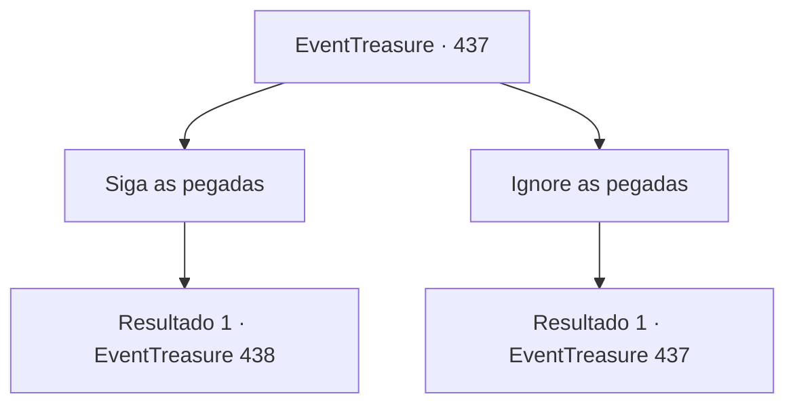

# Eventos de tesouro · 437

[Índice da tabela](index.md) · [Índice geral](../index.md)

ID: `pt:EventTreasure:437` · Fonte: `EventTreasure4` · Versão: 1.2.47.

Mapeamento estático dos arquivos; a disponibilidade e a execução dependem do estado da run.

## Texto do evento

*Sem texto no arquivo.*

## Dados de entrada

```json
{
  "id": 437,
  "grade": 1,
  "place": "",
  "required": ""
}
```

## Mapa das escolhas



## Escolhas e resultados

### Escolha 1

Siga as pegadas

Requisitos e outros campos da escolha:

```json
{
  "required": ""
}
```

#### Resultado 1.1

Você seguiu as pegadas, passo a passo. A nevasca se intensificou, confundindo seu senso de direção e reduzindo seu campo de visão.  Então, através da cortina de neve, algo cintilou à vista. 

 "…Ajude… me."

  Protegendo os olhos com o braço, você olhou mais de perto. No fim da tênue trilha de pegadas jazia uma mulher, semi-enterrada na neve. O rosto dela estava pálido como a morte, os olhos trêmulos fixos em você.

Continuação registrada: [Evento 438](0438.md) na mesma tabela.

```json
{
  "required": "",
  "chance": "1",
  "nextEvent": 438,
  "type": 2,
  "reward": ""
}
```

### Escolha 2

Ignore as pegadas

Requisitos e outros campos da escolha:

```json
{
  "required": "5_877_0"
}
```

#### Resultado 2.1

Você ignorou as pegadas e seguiu em frente. Um passo, depois outro, depois mais outro…  O cansaço da marcha implacável começou a pesar sobre você— até que de repente você percebeu algo estranho.  Você havia retornado ao exato lugar onde havia encontrado pela primeira vez a adaga e as pegadas. A nevasca fustigava com força suas bochechas.

Continuação registrada: [Evento 437](0437.md) na mesma tabela.

```json
{
  "required": "",
  "chance": "1",
  "nextEvent": 437,
  "type": 2,
  "reward": "5_877_1"
}
```

## Referências que chegam a este evento

- [Evento 435 · escolha 2 · resultado 1](0435.md#escolha-2)
- [Evento 435 · escolha 3 · resultado 1](0435.md#escolha-3)
- [Evento 435 · escolha 3 · resultado 3](0435.md#escolha-3)
- [Evento 436 · escolha 1 · resultado 1](0436.md#escolha-1)
- [Evento 436 · escolha 2 · resultado 1](0436.md#escolha-2)
- [Evento 437 · escolha 2 · resultado 1](0437.md#escolha-2)
