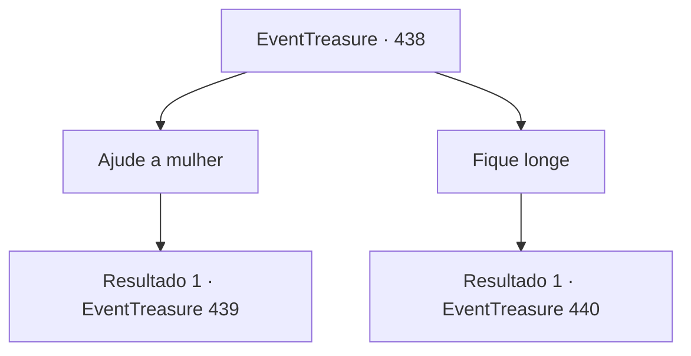

# Eventos de tesouro · 438

[Índice da tabela](index.md) · [Índice geral](../index.md)

ID: `pt:EventTreasure:438` · Fonte: `EventTreasure4` · Versão: 1.2.47.

Mapeamento estático dos arquivos; a disponibilidade e a execução dependem do estado da run.

## Texto do evento

*Sem texto no arquivo.*

## Dados de entrada

```json
{
  "id": 438,
  "grade": 1,
  "place": "",
  "required": ""
}
```

## Mapa das escolhas



## Escolhas e resultados

### Escolha 1

Ajude a mulher

Requisitos e outros campos da escolha:

```json
{
  "required": ""
}
```

#### Resultado 1.1

Você se aproximou para ajudar a mulher. Mas, naquele instante— 

 <link=shake>‘TRRRRRRRREMOR!!’</link> 

 O chão sob você soltou um estrondo ensurdecedor e desabou. Enquanto caía, seu olhar se prendeu ao da mulher.  Não era o rosto de uma viva— mas o semblante de um cadáver.

Continuação registrada: [Evento 439](0439.md) na mesma tabela.

```json
{
  "required": "",
  "chance": "1",
  "nextEvent": 439,
  "type": 2,
  "reward": ""
}
```

### Escolha 2

Fique longe

Requisitos e outros campos da escolha:

```json
{
  "required": "-1|1_14_14|5_877_1"
}
```

#### Resultado 2.1

Você estacou e não se aproximou dela. Nesse exato momento, um estrondo retumbante rasgou o ar quando o chão à sua frente desabou. Você percebeu que mais um passo teria levado você a outra fenda oculta. |drawing_wendigo|  

 "Ajude… me…"

  Você ergueu a cabeça em direção à voz— e ali, onde a mulher fora enterrada, erguia-se uma figura monstruosa.  Seu porte era esquálido, mas imponente, duas vezes o tamanho de um homem adulto. Sobre a cabeça, havia o crânio de um cervo, e suas longas garras pingavam sangue seco.  

 "Heh… heheheh…"

  A criatura cravou o olhar em você, soltando uma risada grotesca.

Continuação registrada: [Evento 440](0440.md) na mesma tabela.

```json
{
  "required": "",
  "chance": "1",
  "nextEvent": 440,
  "type": 2,
  "reward": ""
}
```

## Referências que chegam a este evento

- [Evento 437 · escolha 1 · resultado 1](0437.md#escolha-1)
